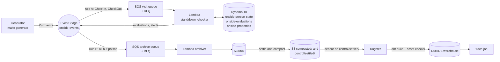

# Onside movement demo

Farm check-ins and movements between properties become biosecurity alerts in real time: an
AWS event chain (EventBridge, SQS, Lambda, DynamoDB, S3). A warehouse built by Dagster and
dbt then recomputes every alert, explains each one that real time missed, and traces how a
disease could have spread. It runs offline on a laptop through LocalStack. The same Terraform
is ready for AWS, with a runbook prepared but not yet run. Design:
[docs/superpowers/specs/2026-10-09-onside-movement-demo-design.md](docs/superpowers/specs/2026-10-09-onside-movement-demo-design.md).

## What it maps to in Onside

| Onside feature | In this demo |
|---|---|
| Check-ins, check-outs and movements | The generator plays the app backend: `CheckIn`, `CheckOut` and `PlantMovement` events on an EventBridge bus; `fct_movements` joins consecutive visits into movements |
| High risk visits (stand-down rules) | The `standdown_checker` Lambda applies the property-type rules on every check-in and emits `HighRiskVisitDetected`; `fct_high_risk_visits` recomputes the same rules in SQL |
| Tracing add-on | `make trace`: the earliest arrival at every property reachable from one property within N hops, over people and plant-material movements (a Dagster job) |
| Key property identification | `dim_property_network`: in/out degree, weighted strength and weighted PageRank of the movement network (a dbt Python model) |
| Reconciliation | `fct_alert_reconciliation`: every breach the warehouse finds is either matched by a real-time alert or missed with a cause proven from DynamoDB item versions |
| Offline, late and duplicate check-ins | About 5% of events arrive late (up to 7 days in the backfill), about 2% are sent twice; the Lambda is order-independent and every stage deduplicates |

## Architecture



- **Real time:** each check-in is evaluated against the person's earlier visits, committed to
  DynamoDB in one transaction with a version check, and alerted on the bus.
- **Settle:** after a run, `make generate` waits until every event and every derived event has
  landed in `raw/`, then writes a few compacted NDJSON files and `control/settled/<run>.json`.
- **Warehouse:** the Dagster sensor sees the settled record and runs `dbt build` (models, dbt
  tests as asset checks, plus completeness, dead-letter-queue and freshness checks). dbt and
  the trace job share one concurrency pool, so only one process opens the DuckDB file at a time.

## Quick starts

**Simulation (no Docker, no AWS):** the Lambda logic runs in process.

    make venv && make test                  # lint and unit tests (about 3 min)
    make sim-e2e                            # a year of check-ins, the simulated Lambda, dbt build
    make trace PROPERTY=P0001 START=2026-06-01T00:00:00+12:00

**LocalStack (the full demo):** LocalStack 4.14.0 community, no token.

    make integration                        # the spec §7.3 test on a fresh stack; it WIPES the
                                            # current stack and backfill, so run it first (about 5 min)
    make up                                 # a fresh, empty LocalStack; also wipes state/local,
                                            # data/local and warehouse/local.duckdb
    make deploy ENV=local                   # Terraform: 26 resources
    make setup ENV=local                    # reference data -> S3 ref/ and DynamoDB
    make generate ENV=local MODE=backfill   # a year of history: emit, settle, compact (about 19 min)
    make dagster ENV=local                  # http://127.0.0.1:3000; the sensor runs dbt once

If a settle times out, resume it with `make settle ENV=local RUN=<run_id>` (the run ids are in
`state/local/manifests/`). Never `make up` to recover: it wipes the stack and the state.

`make deploy` and `make destroy` never default: they need `ENV=local` or `ENV=aws`. After one
online run of the quick start (image pulls, `make venv`, the Terraform providers on the first
`make deploy`, DuckDB's httpfs install), the demo runs with the network off; this was proved
with `unshare -rn` (see Results).

**AWS (prepared, not yet run):** the runbook [docs/aws-deploy.md](docs/aws-deploy.md)
creates a US$5 budget first (`make budget ENV=aws AWS_ACCOUNT_ID=<id> BUDGET_EMAIL=<address>`),
deploys the same Terraform (`make deploy ENV=aws AWS_ACCOUNT_ID=<id>`), runs a small dataset,
and tears it all down. Nothing in this repo touches AWS unless `ENV=aws` is given.

## Demo script (about 5 minutes)

Before the demo: the LocalStack quick start above, so the backfill has settled and Dagster has
run once. Keep `make dagster ENV=local` running in its own terminal.

1. **The story (30 s).** This README's table and diagram.
2. **Live events (1 min).**

        make generate ENV=local MODE=live N=50   # 50 check-ins in the last 30 minutes
        make alerts ENV=local                    # alert count and the last 5 alerts

   The generator makes about 20% of live check-ins deliberate breaches of a stand-down rule:
   the recorded run had 10 breaches in 50 check-ins (14 in the offline rehearsal). That run
   settled in 72 s (105 s in the offline rehearsal). After the backfill, `make alerts ENV=local`
   began with
   `1029 alert log lines, 1008 distinct alerts (by checkin_event_id; repeats are redeliveries or duplicate events)`.
   Each live run adds its own alerts on top of these after-backfill numbers, so the counts
   you see during the demo are higher.
3. **Dagster (1 min).** The `settled_runs` sensor (every 30 s) starts a `dbt_build` run; in
   the offline rehearsal it succeeded 84 s after the live run settled. Show the lineage, the
   run, and the 51 green checks: the dbt tests plus, on `stg_events`, completeness against the
   manifests, the dead-letter queues, and freshness (the live run's lag was 4.6 minutes).
4. **Reconciliation (1.5 min).**

        .venv/bin/python -c "import duckdb; print(duckdb.connect('warehouse/local.duckdb', read_only=True).sql('select status, cause, sub_cause, count(*) from fct_alert_reconciliation group by all order by all'))"

   Read the causes off the output: "X breaches were missed in real time: Y because the
   origin check-in was still offline (`origin_not_seen`, `offline`), Z because of delivery
   order: the origin's check-out had not been processed yet (`origin_end_not_seen`), or the
   origin check-in arrived first but was processed later (`origin_not_seen`, `reordered`).
   Each has version evidence. That is why the warehouse recomputes on event time." After the
   backfill the output was 40 `offline`, 4 `origin_end_not_seen` and no `reordered` row. Run
   the query between Dagster runs: DuckDB allows one writing process, and Dagster holds the
   file only while a run is in the `duckdb` pool.
5. **Tracing and key properties (1 min).**

        make trace ENV=local PROPERTY=P0172 START=2026-06-01T00:00:00+12:00

   It queues the Dagster `trace` job, waits (18 s in the recorded run) and prints the earliest
   arrival per reachable property with its path (62 properties within 3 hops), then the path
   of the JSON result. Then the key properties, by PageRank (P0172 was the top one):

        .venv/bin/python -c "import duckdb; print(duckdb.connect('warehouse/local.duckdb', read_only=True).sql('select property_id, out_degree, round(pagerank, 4) from dim_property_network order by pagerank desc limit 3'))"

6. **Production next steps (30 s).** The list below.

Dead-letter queue, last: `make poison ENV=local K=2` sends malformed events, which reached the
visit DLQ 3 min 02 s later (offline rehearsal); the next `dbt_build` run's
`dead_letter_queues` check then reports 2 poison messages and passes. The poison records are
written first, so a `dbt_build` run in those 3 minutes has a red DLQ check: run poison after
the other steps. DLQ messages expire after 14 days while the poison records stay, so rebuild
the state if the last poison is older than that.

## Results

Measured on a 4-CPU laptop with LocalStack, at the `local` scale (200 properties, 600 people):

| | |
|---|---|
| Backfill | 9,227 check-ins, 8,494 check-outs, 250 plant movements: 18,313 events sent at 108 events/s, settled in 953 s, 1,124 s in total |
| Dagster | webserver up 25 s after `make dagster`; the sensor's first `dbt_build` run took 59 s: `dbt build` PASS=77, WARN=0, ERROR=0, and 51/51 checks passed |
| Reconciliation (after the backfill) | 1,008 matched, equal to the 1,008 distinct alerts from `make alerts` at the same moment; 44 missed, each with a version-proven cause: 40 origin offline, 4 origin check-out not yet seen (none reordered in this run); 0 false alerts, 0 not evaluated, 0 unexplained |
| Live run of 50 | settled in 72 s with 10 breaches; the sensor's next run passed 51/51 checks, freshness lag 4.6 min |
| Trace | P0172: 62 properties within 3 hops in 18.4 s, identical to `python -m tracing` on the same warehouse; submitted during a `dbt_build` run, it waited for the `duckdb` pool (no lock error) |
| Poison K=2 | reached the visit DLQ in 3 min 02 s (offline rehearsal); the next `dead_letter_queues` check passed (2 injected, 2 in the visit DLQ) |
| Offline rehearsal | deploy (0 changes), Dagster, a live run of 50 (settled in 105 s), the sensor's `dbt_build` (51/51), trace and poison: 514 s in total, under `unshare -rn` with only LocalStack relayed |

## Testing

- **Unit (`make test`):** 278 pytest tests pass (the integration test is skipped without
  LocalStack), with moto standing in for AWS. They cover the stand-down rules over the golden
  cases, the processor, both Lambdas, settle, the generator CLI, tracing, the Dagster sensor,
  checks, trace job and definitions, and the Makefile wiring. No Docker needed.
- **dbt (`make sim-e2e`):** generic and singular tests, unit tests, and the golden cases run
  through the same SQL macro as the warehouse (PASS=77).
- **Integration (`make integration`):** the full chain on a fresh LocalStack: out-of-order,
  duplicate, orphan check-out and poison cases, then settle, DynamoDB, S3 and DLQ assertions
  (306 s including the fresh stack and the deploy; the test itself 198 s). CI runs it on
  pushes to main.
- **Parity:** on both the simulation and LocalStack, reconciliation has 0 false alerts, 0 not
  evaluated and 0 unexplained misses, enforced as dbt tests at error level.

## Production next steps

- Incremental dbt models by received time with a lookback window, recomputing only the
  affected people (here every model is rebuilt in full).
- Trim per-person state and keep deduplication in a separate store (the demo bounds a
  person's history at 300 visits instead).
- API Gateway or webhooks for ingestion (the generator plays the app backend).
- Iceberg tables with Athena; ClickHouse for customer-facing reports; BI dashboards.
- Stand-down rules per property and group, and temporary outbreak overrides (the demo has
  rules between property types only).
- Data residency for each customer's region.

## Repo layout

```
generator/        events, reference data, emit, settle and compact, the CLI (make setup/generate/...)
lambdas/          standdown_checker (rules, processor, DynamoDB store, handler) and archiver
dbt/              staging -> intermediate -> marts, tests, the network Python model
orchestration/    Dagster: dbt assets, sensor and schedule, asset checks, trace job
tracing/          the hop-limited earliest-arrival algorithm and its CLI
infra/terraform/  the stack, one codebase for LocalStack and AWS
infra/budget/     the US$5 budget, its own Terraform root
shared/           the stand-down rules and golden cases (Lambda and dbt)
tests/            pytest; tests/integration needs LocalStack
docs/             the design spec, the plans, the AWS runbook
```
