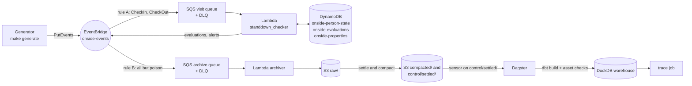

# Plan 3 — Dagster, CI LocalStack job, real-AWS preparation, README Implementation Plan

> **For agentic workers:** REQUIRED SUB-SKILL: Use superpowers:subagent-driven-development (recommended) or superpowers:executing-plans to implement this plan task-by-task. Steps use checkbox (`- [ ]`) syntax for tracking.

**Goal:** Orchestrate the LocalStack/AWS warehouse with Dagster (dbt assets, a sensor on settled
runs, asset checks, a trace job in one DuckDB concurrency pool), prepare the one real-AWS deploy
(budget root, guard, runbook) without running it, add the CI LocalStack job, and rewrite the
README around the demo.

**Architecture:**
- **`orchestration/`** is one Dagster code location for `ONSIDE_ENV=local|aws`. dbt runs as
  `@dbt_assets` over a manifest that `make dagster` parses for the env's target; dbt tests become
  asset checks. Three Python checks on `stg_events` (completeness, DLQ, freshness) read S3
  `control/`, SQS attributes and the warehouse. A sensor lists only `control/settled/` and asks
  for one `dbt_build` run per settled run. The `trace` job wraps the existing tracing code path.
  The dbt op, the warehouse-reading checks and the trace op share the pool `duckdb` (limit 1).
- **AWS access** reuses `generator.aws` (`connect`, `Outputs`, `client`) through one resource.
- **Real AWS** gets a separate Terraform root for the US$5 budget, a Makefile guard that makes
  `deploy ENV=aws` wait for it, and a runbook. Nothing here runs against AWS.

**Tech Stack:**
- Python 3.12; Dagster `1.13.25` (`dagster`, `dagster-webserver`, `dagster-graphql`),
  `dagster-dbt 0.29.25`; dbt-core 1.12.5 with dbt-duckdb 1.11.0; DuckDB 1.5
- moto 5.2 and pytest 9 for every test; ruff 0.16
- Terraform 1.15.8 (≥ 1.9) with `hashicorp/aws 6.68.0`; LocalStack `4.14.0` community
- GitHub Actions (written and checked locally, never run here)

**Spec:** `docs/superpowers/specs/2026-10-09-onside-movement-demo-design.md` (revision 7.2), binding
sections §1, §2 (`orchestration/`), §5 Tracing, §6.4, §7, §8, §9, §10.
**Design brief (binding decisions):** `docs/superpowers/plans/2026-10-10-plan-3-design-brief.md`.
Also read `docs/superpowers/plans/2026-10-10-plan-2-execution-notes.md` (what exists, the Plan 3
preconditions). Authority: spec > brief > this plan. "Decision N" means the brief's decision N.

**Dry run (2026-10-10, while writing the plan).** The plan was first built and validated in a
scratch worktree of `feat/plan-3-dagster` (its own `.venv`, its own LocalStack on 127.0.0.1:4566
after the main checkout's was stopped). Then every block of Tasks 1–12 and 16 was applied task by
task to a second, fresh worktree (its venv first built without Dagster) by a script that reads
the blocks and runs the steps: all 12 RED steps failed with the stated error, and all 32 GREEN,
output and commit steps passed (13 commits, `make fmt` a no-op each time). The replayed tree is
identical to the validated one (same git tree hash). Measured:
- **Unit:** `make test` 269 passed, 1 skipped (the integration test without `LOCALSTACK=1`) in
  2 min 40 s; `make tf-check` validates both roots (50–80 s the first time, provider download
  included).
  Importing Dagster makes the existing sim tests about 70% slower (their `deepcopy`-heavy store
  runs in a bigger heap; profiled, not a bug), which is why `make test` grew from 1.5 minutes.
- **`make integration`** on a fresh stack with the `onside-*` tables: 1 passed in 196.5 s
  (295 s wall). `make deploy ENV=local`: 26 resources, 1 min 29 s (2 min 05 s with the provider
  download).
- **Backfill** at the reduced scale (`make setup ENV=local SCALE=aws`; the full `local` scale took
  about 17 minutes in Plan 2 and is what Task 13 runs): 5,604 events at 126 events/s, settled in
  281 s, 326 s wall.
- **Dagster** (`make dagster ENV=local`): webserver up 16 s after start (including `dbt parse`);
  the sensor's first run (run key = the backfill run id) SUCCEEDED 58 s after start; the run took
  31.9 s; checks 51/51 passed (48 dbt tests + completeness, DLQ, freshness); dbt PASS=77; the next
  ticks skipped. Reconciliation: 476 matched; missed 20 offline, 5 reordered,
  3 origin_end_not_seen; 0 false alerts, 0 unexplained.
- **Live run N=50:** settled in 46 s; the sensor fired once more; checks 51/51; freshness lag
  2.9 minutes.
- **Trace:** `make trace ENV=local PROPERTY=P0003 START=2026-06-01T00:00:00+12:00` → 28 properties
  in 14.9 s, identical to the module's table. A trace submitted during a dbt run started at
  35.1 s, after the dbt run's last pool step ended (24.2 s): queued, no lock error.
- **Cold start:** the checker logged `"tzpath": []` on LocalStack.
- **Offline rehearsal** (`unshare -rn`, LocalStack relayed over a Unix socket): deploy (0
  changes), `dagster dev`, live run (settled 58 s), the sensor's dbt run (51/51), `make trace`,
  `make poison K=2` (DLQ after 3 min 11 s) and a dbt run whose DLQ check saw P=2, visit DLQ 2:
  all passed, 402 s.
- **Teardown:** Dagster stopped, `docker compose down -v` in the scratch worktree, both worktrees
  removed, the main checkout's LocalStack brought back up empty (`make up`). Nothing ran against
  real AWS (`ENV=aws` only in `make -n` and `terraform validate`); no AWS credentials exist on the
  machine.

A failure while executing therefore most likely means a copy slip or an environment difference,
not a design gap.

## Decisions the brief did not cover / deviations

- **Manifest (decision 4 let the plan choose):** `make dagster` runs `dbt parse --target <env>`
  into `state/<env>/dagster/dbt/` (gitignored, wiped by `make up` with the rest of
  `state/local/`); the code reads that manifest and never calls `prepare_if_dev()`.
- **Completeness (decision 6 let the plan choose):** counted in DuckDB `stg_events`, restricted
  to the event ids of settled runs (`uuid5(run_id, seq)`), because settle can compact an
  unsettled run's raw objects that share an hour prefix.
- **Freshness:** "its max `received_time`" is read from the warehouse (the live run's events in
  `stg_events`), and no event of the run in the warehouse fails the check. Before any settled run
  the check passes with `skipped: no settled run`.
- **Sensor cursor:** the greatest `LastModified` plus *every* key at that instant (a superset of
  "LastModified with the key"), so two objects written in the same second each fire once. A
  re-written settled object asks again with the same run key, which Dagster drops.
- **Pool config:** `concurrency.pools.default_limit: 1, granularity: op` in `dagster.yaml`;
  `duckdb` is the only pool, so it gets limit 1 (verified with `get_concurrency_info`). Telemetry
  is off for the offline demo.
- **No `from __future__ import annotations` in `orchestration/`:** with it, Dagster 1.13 rejects
  `context: AssetExecutionContext` and cannot resolve the op's config class (both failed in the
  dry run).
- **`make trace ENV=local|aws`:** probes `http://127.0.0.1:3000/server_info` (exit 2 with the brief's
  message if nothing answers), then submits over GraphQL and polls. Its config carries `env`, so
  a Dagster running for the other env refuses the run; the op records errors in the result file,
  which the submit path prints. A start time without an offset is now refused in every env.
- **Not asked by the brief, added because the runbook needs them:** `make dbt-debug` (M14),
  `make budget-destroy`, the checker's one-line cold-start log of `zoneinfo.TZPATH`
  (precondition 8), and `DBT_S3_REGION` from the outputs for both S3 targets (precondition 9).
- **Background `dagster dev`:** a command started with `&` by a non-interactive shell ignores
  SIGINT and SIGTERM, and `dagster dev` keeps that, so Tasks 14–15 start it through a launcher
  that resets both signals and stop it with `pkill -INT`.
- **CI:** `actionlint` is not installed, so a pytest test pins the workflow's shape;
  `terraform_wrapper: false` in the `localstack` job, because `make deploy` pipes
  `terraform output -json` into a file.
- **pip** downgrades `sqlglot` 30.22 → 28.0 for dagster-dbt; dbt builds unchanged (PASS=77).
- **Dry-run scale:** the dry run used `SCALE=aws` for the LocalStack backfill (as the controller
  allowed); Task 13 specifies the full `local` scale.

**Out of scope (Harvey decides):** anything that reaches real AWS (deploy, budget, screenshots),
`git push`, running CI, merging, a LocalStack token. **Never run `make budget`,
`make budget-destroy`, or any target with `ENV=aws` except under `make -n`.**

## Global Constraints

- Python **3.12**; the project venv is `.venv`. **Always call `.venv/bin/dbt`** (the global
  `~/.local/bin/dbt` is dbt Fusion 2.0 without a DuckDB adapter); Dagster gets the same through
  `DBT_EXECUTABLE` (Task 8).
- **Version pins:** `dagster~=1.13.25`, `dagster-webserver~=1.13.25`, `dagster-dbt~=0.29.25`
  (extra `[orchestration]`, also in `dev`); unchanged: `dbt-duckdb~=1.11.0`, `duckdb>=1.5,<1.6`,
  `moto[s3,dynamodb,sqs,events]~=5.2`, `pytest~=9.1`, `ruff~=0.16`, Terraform providers
  `hashicorp/aws ~> 6.0` (lock 6.68.0), image `localstack/localstack:4.14.0`.
- **Dagster:** `make dagster ENV=local|aws` only (never `sim`); `dagster dev` on
  `127.0.0.1:3000` only; `DAGSTER_HOME=state/<env>/dagster` (gitignored); runs through
  `QueuedRunCoordinator`; pool `duckdb` limit 1 on every op that opens `warehouse/<env>.duckdb`.
  No `from __future__ import annotations` in `orchestration/*.py`.
- **Asset checks and the sensor only read:** S3 `control/` (never `raw/`), SQS
  `ApproximateNumberOfMessages` (never receive), DuckDB read-only.
- **Tables:** `onside-person-state`, `onside-evaluations`, `onside-properties` everywhere.
- **Never touch real AWS.** Unit tests run inside moto (`aws`/`deployed` fixtures) or with
  `generator.aws.client` patched; Makefile tests use `make -n` or guards that stop first. Only one
  LocalStack may listen on :4566 — check `docker ps` before `make up`. **Never push.**
- **Timestamps:** ISO 8601 with a UTC offset; "local" means `Pacific/Auckland`.
- All code comments and docs are in English.
- Before each commit, run `make fmt` and `make test`; both must pass (`make test` takes about
  2.5–3 minutes; it needs no Docker).
- **Commit trailers:** end every commit message with these two lines:
  ```
  Co-Authored-By: Claude Opus 5.5 (1M context) <noreply@anthropic.com>
  Claude-Session: https://claude.ai/code/session_012WEa92bbXCjYuZcpoBBmiL
  ```

## Review Focus

Five conditions the spec implies that the obvious tests would miss. Each is pinned by a test in
the task that owns the code:

1. **LocalStack restarted under a running `dagster dev`** (the bucket is gone, `outputs.json`
   survives). The sensor must skip with the `make up` hint every 30 s, not error-loop or fire.
   Task 5, `test_a_lost_stack_skips_with_the_make_up_hint`.
2. **A settle that timed out and was resumed later.** Its raw objects can be compacted into
   another run's part before it settles; completeness must neither count them nor call the
   unsettled run missing. Task 6, `test_completeness_passes_when_every_settled_event_is_in_staging`
   (its two unsettled runs).
3. **Two runs settled within the same second** (S3 `LastModified` has one-second resolution).
   Each must fire exactly once. Task 5, `test_objects_written_in_the_same_second_each_fire_once`.
4. **`make trace` against the wrong Dagster, no Dagster, or a start time without an offset.**
   Clear errors (exit 2, or a failed run with the reason printed), never a trace of the wrong
   warehouse or a time read as the laptop's zone. Task 7,
   `test_a_trace_for_another_env_fails`, `test_submit_without_dagster_dev_says_start_it_first`,
   `test_submit_refuses_a_start_without_offset_before_queueing`; Task 3,
   `test_start_time_without_an_offset_is_refused`.
5. **A `dbt` on `PATH` that is not the project's** (here `~/.local/bin/dbt` is dbt Fusion). The
   Dagster dbt resource must use the venv's dbt-core. Task 8,
   `test_dbt_runs_with_the_venv_dbt_core_and_the_env_target`.

Also pinned: a destroyed budget (state with `"resources": []`) still blocks `deploy ENV=aws`
(Task 10), and `make` called from tests ignores the caller's `MAKEFLAGS` (Task 9, `tests.helpers.make`).

---

## File Structure

```
onside_movement_demo/
├── pyproject.toml                         # Task 1: [orchestration] extra, also in dev
├── Makefile                               # Task 9 (dagster, trace, region), 10 (budget, guard,
│                                          #   tf-check), 12 (dbt-debug)
├── .gitignore                             # Task 10: infra/budget state and data dirs
├── .github/workflows/ci.yml               # Task 11: job localstack
├── README.md                              # Task 16
├── docs/aws-deploy.md                     # Task 12: the AWS runbook
├── dbt/profiles.yml                       # Task 9: DBT_S3_REGION
├── generator/aws.py                       # Task 4: Connection.objects, get_json
├── tracing/cli.py                         # Task 3: trace_warehouse, format_table, TraceError
├── lambdas/standdown_checker/handler.py   # Task 12: cold-start TZPATH log
├── orchestration/
│   ├── __init__.py  resources.py          # Task 4: OnsideResource, POOL, check_env
│   ├── sensors.py                         # Task 5: settled_runs sensor, daily_dbt_build schedule
│   ├── checks.py                          # Task 6: completeness, dead_letter_queues, freshness
│   ├── trace_job.py                       # Task 7: trace job, submit path (python -m)
│   ├── dbt_assets.py  definitions.py      # Task 8: dbt assets, Definitions
│   └── dagster.yaml                       # Task 9: instance (queue, pool, telemetry off)
├── infra/terraform/storage.tf             # Task 2: onside-* tables
├── infra/budget/                          # Task 10: versions, variables, main, lock file
└── tests/
    ├── aws_fixtures.py  conftest.py       # Tasks 2, 4: table constants, `deployed` fixture
    ├── helpers.py                         # Tasks 7, 9: build_trace_warehouse, make()
    ├── test_table_names.py                # Task 2
    ├── test_orchestration_resources.py    # Task 4
    ├── test_orchestration_sensors.py      # Task 5
    ├── test_orchestration_checks.py       # Task 6
    ├── test_orchestration_trace.py        # Task 7
    ├── test_orchestration_definitions.py  # Task 8
    ├── test_makefile.py  test_orchestration_instance.py   # Task 9 (+ Task 12)
    ├── test_budget.py                     # Task 10
    ├── test_ci_workflow.py                # Task 11
    └── test_docs.py                       # Task 12
```

Order: unit-testable pieces first (Tasks 1–12, no Docker), then the LocalStack and Dagster proofs
(13–15), then the README with their numbers (16). Tasks 13–16 leave LocalStack running with the
demo state (a settled full backfill and live runs) and Dagster stopped.

---

### Task 1: Orchestration toolchain (brief decision 1)

**Files:**
- Modify: `pyproject.toml` (extra `[orchestration]`, also pulled into `dev`; package `orchestration`)
- Test: `tests/test_toolchain.py`

**Interfaces:**
- Consumes: nothing new.
- Produces: `dagster 1.13.25`, `dagster-webserver 1.13.25`, `dagster-graphql 1.13.25` (a dependency
  of the webserver) and `dagster-dbt 0.29.25` in `.venv`, next to the unchanged `dbt-core 1.12.5`
  and `dbt-duckdb 1.11.0`; the package `orchestration` is installable (Task 4 creates it).

The pins resolve together with the dbt stack (dry run: `pip install --dry-run` and `pip check`
clean). pip downgrades `sqlglot` from 30.22 to 28.0 (dagster-dbt's bound); dbt still builds
PASS=77 with it.

- [ ] **Step 1: Write the failing test**

Append to the end of `tests/test_toolchain.py`:

```python


def test_orchestration_pins_resolve_with_the_dbt_stack():
    from importlib.metadata import version

    assert version("dagster").startswith("1.13.")
    assert version("dagster-webserver").startswith("1.13.")
    assert version("dagster-dbt").startswith("0.29.")
    assert version("dbt-core").startswith("1.12.")
    assert version("dbt-duckdb").startswith("1.11.")
```

- [ ] **Step 2: Run it to make sure it fails**

Run: `.venv/bin/pytest -q tests/test_toolchain.py`
Expected: FAIL — `importlib.metadata.PackageNotFoundError: No package metadata was found for dagster`.

- [ ] **Step 3: Add the pins and the package**

In `pyproject.toml`, replace this text (it occurs once):

```toml
[project.optional-dependencies]
dev = ["pytest~=9.1", "ruff~=0.16", "moto[s3,dynamodb,sqs,events]~=5.2"]
```

with:

```toml
[project.optional-dependencies]
# Dagster for ENV=local|aws (spec §6.4); also in dev so `make test` covers orchestration/.
orchestration = ["dagster~=1.13.25", "dagster-webserver~=1.13.25", "dagster-dbt~=0.29.25"]
dev = [
  "pytest~=9.1",
  "ruff~=0.16",
  "moto[s3,dynamodb,sqs,events]~=5.2",
  "onside-movement-demo[orchestration]",
]
```

In `pyproject.toml`, replace this text (it occurs once):

```toml
include = ["generator*", "tracing*", "standdown_checker*", "archiver*"]
```

with:

```toml
include = ["generator*", "tracing*", "orchestration*", "standdown_checker*", "archiver*"]
```

- [ ] **Step 4: Install and run the test again**

Run: `make venv 2>&1 | tail -1 && .venv/bin/pip check && .venv/bin/pytest -q tests/test_toolchain.py`
Expected: PASS — `Successfully installed ...`, `No broken requirements found.`, `4 passed`. (`make venv` re-runs `pip install -e '.[dev]'`, about 1 minute.)

- [ ] **Step 5: Commit**

Run:

```bash
make fmt && make test
git add pyproject.toml \
  tests/test_toolchain.py
git status --short   # nothing else may be staged or left over
git commit -m "$(cat <<'EOF'
Orchestration toolchain: dagster 1.13 and dagster-dbt 0.29 as an extra, also in dev

Co-Authored-By: Claude Opus 5.5 (1M context) <noreply@anthropic.com>
Claude-Session: https://claude.ai/code/session_012WEa92bbXCjYuZcpoBBmiL
EOF
)"
```

Expected: `make fmt` changes nothing, `make test` passes, `git status --short` shows only the files above as staged, and the commit succeeds.

---

### Task 2: DynamoDB table prefixes (M7, brief decision 8)

**Files:**
- Modify: `infra/terraform/storage.tf` (table names)
- Modify: `tests/aws_fixtures.py` (`MotoStack` names and outputs)
- Modify: `tests/test_dynamo_store.py`, `tests/test_standdown_handler.py`, `tests/test_cli_aws.py`
  (hard-coded names)
- Test: `tests/test_table_names.py`

**Interfaces:**
- Consumes: nothing new.
- Produces: tables `onside-person-state`, `onside-evaluations`, `onside-properties` (Terraform
  outputs `person_table`, `evaluation_table`, `property_table`, unchanged keys); constants
  `PERSON_TABLE`, `EVALUATION_TABLE`, `PROPERTY_TABLE` in `tests/aws_fixtures.py`.

The Lambda reads its table names from the environment Terraform sets, the generator and the
integration test from `state/<env>/outputs.json`, so no runtime code changes. The Terraform
resource addresses stay the same; on LocalStack the rename replaces the three tables, which is
why Task 13 rebuilds the demo state from `make up`.

- [ ] **Step 1: Write the failing test**

Create `tests/test_table_names.py`:

```python
"""M7: the DynamoDB tables carry the onside- prefix, the same in Terraform and in moto."""

import re
from pathlib import Path

from tests.aws_fixtures import EVALUATION_TABLE, PERSON_TABLE, PROPERTY_TABLE

ROOT = Path(__file__).resolve().parents[1]
TABLE = re.compile(r'resource "aws_dynamodb_table" "(\w+)" \{\s*name\s*=\s*"([^"]+)"')


def terraform_tables() -> dict[str, str]:
    return dict(TABLE.findall((ROOT / "infra" / "terraform" / "storage.tf").read_text()))


def test_terraform_tables_are_prefixed():
    assert terraform_tables() == {
        "person_state": "onside-person-state",
        "evaluations": "onside-evaluations",
        "properties": "onside-properties",
    }


def test_moto_stack_uses_the_terraform_names(aws):
    assert {PERSON_TABLE, EVALUATION_TABLE, PROPERTY_TABLE} == set(terraform_tables().values())
    assert set(aws.dynamodb.list_tables()["TableNames"]) == set(terraform_tables().values())
    outputs = {k: v["value"] for k, v in aws.outputs().items()}
    assert (outputs["person_table"], outputs["evaluation_table"], outputs["property_table"]) == (
        PERSON_TABLE,
        EVALUATION_TABLE,
        PROPERTY_TABLE,
    )
```

- [ ] **Step 2: Run it to make sure it fails**

Run: `.venv/bin/pytest -q tests/test_table_names.py`
Expected: FAIL — collection error: `ImportError: cannot import name 'EVALUATION_TABLE' from 'tests.aws_fixtures'`.

- [ ] **Step 3: Rename the tables in Terraform and in the moto stack**

In `infra/terraform/storage.tf`, replace this text (it occurs once):

```hcl
  name         = "person_state"
```

with:

```hcl
  name         = "onside-person-state"
```

In `infra/terraform/storage.tf`, replace this text (it occurs once):

```hcl
  name         = "evaluations"
```

with:

```hcl
  name         = "onside-evaluations"
```

In `infra/terraform/storage.tf`, replace this text (it occurs once):

```hcl
  name         = "properties"
```

with:

```hcl
  name         = "onside-properties"
```

In `tests/aws_fixtures.py`, replace this text (it occurs once):

```python
REGION = "ap-southeast-2"
TABLE_KEYS = {
    "person_state": "person_id",
    "evaluations": "checkin_event_id",
    "properties": "property_id",
}
```

with:

```python
REGION = "ap-southeast-2"
# The Terraform table names (infra/terraform/storage.tf; M7: the onside- prefix).
PERSON_TABLE = "onside-person-state"
EVALUATION_TABLE = "onside-evaluations"
PROPERTY_TABLE = "onside-properties"
TABLE_KEYS = {
    PERSON_TABLE: "person_id",
    EVALUATION_TABLE: "checkin_event_id",
    PROPERTY_TABLE: "property_id",
}
```

In `tests/aws_fixtures.py`, replace this text (it occurs once):

```python
            "person_table": "person_state",
            "evaluation_table": "evaluations",
            "property_table": "properties",
```

with:

```python
            "person_table": PERSON_TABLE,
            "evaluation_table": EVALUATION_TABLE,
            "property_table": PROPERTY_TABLE,
```

In `tests/aws_fixtures.py`, replace this text (it occurs once):

```python
                TableName="properties",
```

with:

```python
                TableName=PROPERTY_TABLE,
```

- [ ] **Step 4: Use the constants in the tests that named the tables**

In `tests/test_dynamo_store.py`, replace this text (it occurs once):

```python
from tests.helpers import PROPERTIES, checkin, checkout, run
```

with:

```python
from tests.aws_fixtures import EVALUATION_TABLE, PERSON_TABLE, PROPERTY_TABLE
from tests.helpers import PROPERTIES, checkin, checkout, run
```

In `tests/test_dynamo_store.py`, replace this text (it occurs once):

```python
    return DynamoDbStore(stack.dynamodb, "person_state", "evaluations", "properties")
```

with:

```python
    return DynamoDbStore(stack.dynamodb, PERSON_TABLE, EVALUATION_TABLE, PROPERTY_TABLE)
```

In `tests/test_dynamo_store.py`, replace this text (it occurs once):

```python
    person = aws.dynamodb.get_item(TableName="person_state", Key={"person_id": {"S": "U1"}})
```

with:

```python
    person = aws.dynamodb.get_item(TableName=PERSON_TABLE, Key={"person_id": {"S": "U1"}})
```

In `tests/test_dynamo_store.py`, replace this text (it occurs once):

```python
        TableName="evaluations", Key={"checkin_event_id": {"S": "A"}}
```

with:

```python
        TableName=EVALUATION_TABLE, Key={"checkin_event_id": {"S": "A"}}
```

In `tests/test_dynamo_store.py`, replace this text (it occurs once):

```python
    aws.dynamodb.delete_item(TableName="properties", Key={"property_id": {"S": "P1"}})
```

with:

```python
    aws.dynamodb.delete_item(TableName=PROPERTY_TABLE, Key={"property_id": {"S": "P1"}})
```

In `tests/test_standdown_handler.py`, replace this text (it occurs once):

```python
from tests.helpers import PROPERTIES, ROOT, RULES, TickingClock, checkin, checkout
```

with:

```python
from tests.aws_fixtures import EVALUATION_TABLE, PERSON_TABLE, PROPERTY_TABLE
from tests.helpers import PROPERTIES, ROOT, RULES, TickingClock, checkin, checkout
```

In `tests/test_standdown_handler.py`, replace this text (it occurs once):

```python
    return DynamoDbStore(aws.dynamodb, "person_state", "evaluations", "properties")
```

with:

```python
    return DynamoDbStore(aws.dynamodb, PERSON_TABLE, EVALUATION_TABLE, PROPERTY_TABLE)
```

In `tests/test_standdown_handler.py`, replace this text (it occurs once):

```python
    monkeypatch.setenv("PERSON_TABLE", "person_state")
    monkeypatch.setenv("EVALUATION_TABLE", "evaluations")
    monkeypatch.setenv("PROPERTY_TABLE", "properties")
```

with:

```python
    monkeypatch.setenv("PERSON_TABLE", PERSON_TABLE)
    monkeypatch.setenv("EVALUATION_TABLE", EVALUATION_TABLE)
    monkeypatch.setenv("PROPERTY_TABLE", PROPERTY_TABLE)
```

In `tests/test_standdown_handler.py`, replace this text (it occurs once):

```python
    item = aws.dynamodb.get_item(TableName="evaluations", Key={"checkin_event_id": {"S": "A"}})
```

with:

```python
    item = aws.dynamodb.get_item(TableName=EVALUATION_TABLE, Key={"checkin_event_id": {"S": "A"}})
```

In `tests/test_cli_aws.py`, replace this text (it occurs once):

```python
from generator.cli import main
```

with:

```python
from generator.cli import main
from tests.aws_fixtures import PROPERTY_TABLE
```

In `tests/test_cli_aws.py`, replace this text (it occurs once):

```python
    items = aws.dynamodb.scan(TableName="properties")["Items"]
```

with:

```python
    items = aws.dynamodb.scan(TableName=PROPERTY_TABLE)["Items"]
```

- [ ] **Step 5: Run the tests and check that no bare table name is left**

Run: `.venv/bin/pytest -q tests/test_table_names.py tests/test_dynamo_store.py tests/test_standdown_handler.py tests/test_cli_aws.py && terraform fmt -check -recursive infra`
Expected: PASS — `59 passed`; `terraform fmt` prints nothing.

Run: `grep -rnE '"(person_state|evaluations|properties)"' tests lambdas generator infra/terraform/*.tf`
Expected: OUTPUT — only `generator/local_sim.py` (its JSON key `evaluations`), `generator/cli.py` and `generator/reference.py` (the `properties` reference file); those are not table names.

- [ ] **Step 6: Commit**

Run:

```bash
make fmt && make test
git add infra/terraform/storage.tf \
  tests/aws_fixtures.py \
  tests/test_table_names.py \
  tests/test_dynamo_store.py \
  tests/test_standdown_handler.py \
  tests/test_cli_aws.py
git status --short   # nothing else may be staged or left over
git commit -m "$(cat <<'EOF'
M7: prefix the DynamoDB tables with onside- in Terraform and the moto stack

Co-Authored-By: Claude Opus 5.5 (1M context) <noreply@anthropic.com>
Claude-Session: https://claude.ai/code/session_012WEa92bbXCjYuZcpoBBmiL
EOF
)"
```

Expected: `make fmt` changes nothing, `make test` passes, `git status --short` shows only the files above as staged, and the commit succeeds.

---

### Task 3: Tracing has one code path for the CLI and the Dagster job (brief decision 7)

**Files:**
- Modify: `tracing/cli.py` (whole file)
- Test: `tests/test_tracing_cli.py`

**Interfaces:**
- Consumes: `tracing.core.trace(edges, seed, start, max_hops) -> list[Reached]`,
  `tracing.cli.load_edges(con)` (both unchanged).
- Produces (used by Task 7):
  - `class TraceError(ValueError)`: user-facing tracing errors;
  - `parse_start(value: str) -> datetime` (ISO 8601 **with** offset, else `TraceError`);
  - `trace_warehouse(db: Path | str, property_id: str, start: str, max_hops: int) -> list[dict]`,
    opening DuckDB read-only; each dict has `property_id`, `property_type`, `hops`,
    `arrival` (ISO 8601 in Pacific/Auckland) and `path` (list of property ids);
  - `format_table(rows: list[dict], property_id: str, max_hops: int) -> str`, the exact table
    `make trace ENV=sim` printed before.

`make trace ENV=sim` keeps its output byte for byte (the three existing tests pin it). New: a start
time without an offset is refused instead of being read as the machine's local time, and a
missing warehouse file is a clear error instead of a DuckDB `IOException`.

- [ ] **Step 1: Write the failing tests**

In `tests/test_tracing_cli.py`, replace this text (it occurs once):

```python
from tracing.cli import main
```

with:

```python
from tracing.cli import TraceError, format_table, main, trace_warehouse
```

Append to the end of `tests/test_tracing_cli.py`:

```python


def test_trace_warehouse_returns_one_row_per_reached_property(db):
    rows = trace_warehouse(db, "P1", "2026-03-03T09:00:00+13:00", 3)
    assert rows == [
        {
            "property_id": "P1",
            "property_type": "poultry",
            "hops": 0,
            "arrival": "2026-03-03T09:00:00+13:00",
            "path": ["P1"],
        },
        {
            "property_id": "P2",
            "property_type": "poultry",
            "hops": 1,
            "arrival": "2026-03-03T12:00:00+13:00",
            "path": ["P1", "P2"],
        },
    ]
    table = format_table(rows, "P1", 3).splitlines()
    assert table[0] == "2 properties reached from P1 within 3 hops"
    assert table[-1].split() == ["1", "P2", "poultry", "2026-03-03", "12:00", "P1", "->", "P2"]


def test_start_time_without_an_offset_is_refused(db, capsys):
    code = main(["--db", str(db), "--property", "P1", "--start", "2026-03-03T09:00:00"])
    assert code == 2
    assert "needs a UTC offset" in capsys.readouterr().err


def test_missing_warehouse_is_a_clear_error(tmp_path):
    with pytest.raises(TraceError, match="no warehouse at"):
        trace_warehouse(tmp_path / "none.duckdb", "P1", "2026-03-03T09:00:00+13:00", 3)
    assert not (tmp_path / "none.duckdb").exists()  # read-only: nothing is created
```

- [ ] **Step 2: Run them to make sure they fail**

Run: `.venv/bin/pytest -q tests/test_tracing_cli.py`
Expected: FAIL — collection error: `ImportError: cannot import name 'TraceError' from 'tracing.cli'`.

- [ ] **Step 3: Split the CLI into reusable functions**

Replace the whole of `tracing/cli.py` with:

```python
"""Tracing over the warehouse (spec §5 Tracing): the CLI for sim and the Dagster job's code path."""

from __future__ import annotations

import argparse
import sys
from datetime import UTC, datetime
from pathlib import Path
from zoneinfo import ZoneInfo

import duckdb

from .core import Edge, trace

NZ = ZoneInfo("Pacific/Auckland")

EDGES_SQL = """
select origin_property_id, dest_property_id, epoch(departure_time), epoch(arrival_time)
from fct_movements
where connected
union all
select
    source_property_id,
    dest_property_id,
    epoch(cast(movement_date as timestamp) at time zone 'Pacific/Auckland'),
    epoch(cast(movement_date + 1 as timestamp) at time zone 'Pacific/Auckland') - 1
from stg_plant_movements
"""


class TraceError(ValueError):
    """A user-facing tracing error (unknown property, bad start time, no warehouse)."""


def load_edges(con: duckdb.DuckDBPyConnection) -> list[Edge]:
    return [
        Edge(src, dst, float(dep), float(arr))
        for src, dst, dep, arr in con.sql(EDGES_SQL).fetchall()
    ]


def parse_start(value: str) -> datetime:
    try:
        start = datetime.fromisoformat(value)
    except ValueError:
        raise TraceError(f"start time {value!r} is not ISO 8601") from None
    if start.tzinfo is None:
        raise TraceError(f"start time {value!r} needs a UTC offset, e.g. +12:00")
    return start


def trace_warehouse(db: Path | str, property_id: str, start: str, max_hops: int) -> list[dict]:
    """Trace from one property over a read-only warehouse; one dict per reached property."""
    started = parse_start(start)
    if max_hops < 0:
        raise TraceError(f"max_hops must be 0 or more, not {max_hops}")
    if not Path(db).exists():
        raise TraceError(f"no warehouse at {db}; build it first (dbt build)")
    con = duckdb.connect(str(db), read_only=True)
    try:
        known = con.execute(
            "select property_type from stg_properties where property_id = ?", [property_id]
        ).fetchone()
        if known is None:
            raise TraceError(f"unknown property {property_id}")
        types = dict(con.sql("select property_id, property_type from stg_properties").fetchall())
        reached = trace(load_edges(con), property_id, started.timestamp(), max_hops)
    finally:
        con.close()
    return [
        {
            "property_id": r.property_id,
            "property_type": types.get(r.property_id, "?"),
            "hops": r.hops,
            "arrival": datetime.fromtimestamp(r.arrival, tz=UTC).astimezone(NZ).isoformat(),
            "path": list(r.path),
        }
        for r in reached
    ]


def format_table(rows: list[dict], property_id: str, max_hops: int) -> str:
    lines = [
        f"{len(rows)} properties reached from {property_id} within {max_hops} hops",
        f"{'hops':>4}  {'property':<8}  {'type':<10}  {'earliest arrival':<16}  path",
    ]
    for r in rows:
        local = datetime.fromisoformat(r["arrival"]).astimezone(NZ).strftime("%Y-%m-%d %H:%M")
        lines.append(
            f"{r['hops']:>4}  {r['property_id']:<8}  {r['property_type']:<10}  "
            f"{local:<16}  {' -> '.join(r['path'])}"
        )
    return "\n".join(lines)


def main(argv: list[str] | None = None) -> int:
    parser = argparse.ArgumentParser(prog="tracing")
    parser.add_argument("--db", required=True)
    parser.add_argument("--property", required=True)
    parser.add_argument("--start", required=True, help="infection start, ISO 8601 with offset")
    parser.add_argument("--max-hops", type=int, default=3)
    args = parser.parse_args(argv)
    try:
        rows = trace_warehouse(args.db, args.property, args.start, args.max_hops)
    except TraceError as exc:
        print(f"error: {exc}", file=sys.stderr)
        return 2
    print(format_table(rows, args.property, args.max_hops))
    return 0
```

- [ ] **Step 4: Run the tracing tests**

Run: `.venv/bin/pytest -q tests/test_tracing_cli.py tests/test_tracing_core.py`
Expected: PASS — `11 passed`.

- [ ] **Step 5: Commit**

Run:

```bash
make fmt && make test
git add tracing/cli.py \
  tests/test_tracing_cli.py
git status --short   # nothing else may be staged or left over
git commit -m "$(cat <<'EOF'
tracing: trace_warehouse and format_table shared by the CLI and Dagster; offset required

Co-Authored-By: Claude Opus 5.5 (1M context) <noreply@anthropic.com>
Claude-Session: https://claude.ai/code/session_012WEa92bbXCjYuZcpoBBmiL
EOF
)"
```

Expected: `make fmt` changes nothing, `make test` passes, `git status --short` shows only the files above as staged, and the commit succeeds.

---

### Task 4: S3 listing helpers and the Dagster resource (brief decision 2)

**Files:**
- Modify: `generator/aws.py` (`Connection.objects`, `Connection.get_json`)
- Create: `orchestration/__init__.py`, `orchestration/resources.py`
- Modify: `tests/conftest.py` (fixture `deployed`)
- Test: `tests/test_aws_env.py`, `tests/test_orchestration_resources.py`

**Interfaces:**
- Consumes: `generator.aws.connect(env) -> Connection`, `load_outputs`, `generator.config.state_dir`,
  `warehouse_path`, `generator.state.GeneratorError`.
- Produces:
  - `Connection.objects(prefix: str) -> list[dict]` (S3 listing entries with `Key` and
    `LastModified`; a lost bucket or a down LocalStack raises `GeneratorError` with the
    `make up` hint, exactly as `keys` did); `Connection.keys` now uses it;
  - `Connection.get_json(key: str)`;
  - `orchestration.resources.POOL = "duckdb"`, `DAGSTER_ENVS = ("local", "aws")`,
    `check_env(env: str | None) -> str` (raises `GeneratorError` for anything else);
  - `class OnsideResource(ConfigurableResource)` with field `env: str` and methods
    `connection() -> Connection`, `warehouse() -> Path`, `trace_dir() -> Path`
    (`state/<env>/trace`);
  - pytest fixture `deployed` (in `tests/conftest.py`): a `REPO_ROOT` in `tmp_path` holding
    `state/local/outputs.json` of the moto stack, with `generator.aws.client` patched to moto.

Dagster modules never use `from __future__ import annotations` (see Global Constraints).

- [ ] **Step 1: Write the failing tests**

Append to the end of `tests/test_aws_env.py`:

```python


def test_objects_carry_last_modified_and_get_json_reads_back(aws):
    conn = _connection(aws)
    conn.put_json("control/settled/run-1.json", {"run_id": "run-1"})
    conn.put_json("raw/2026/10/10/01/x.ndjson", {})
    [entry] = conn.objects("control/settled/")
    assert entry["Key"] == "control/settled/run-1.json"
    assert entry["LastModified"].tzinfo is not None
    assert conn.get_json(entry["Key"]) == {"run_id": "run-1"}
    aws.s3.delete_object(Bucket=aws.bucket, Key="control/settled/run-1.json")
    aws.s3.delete_object(Bucket=aws.bucket, Key="raw/2026/10/10/01/x.ndjson")
    aws.s3.delete_bucket(Bucket=aws.bucket)
    with pytest.raises(S.GeneratorError, match="make up"):
        conn.objects("control/settled/")
```

In `tests/conftest.py`, replace this text (it occurs once):

```python
import os

import pytest
from moto import mock_aws

from tests.aws_fixtures import REGION, MotoStack
```

with:

```python
import json
import os

import boto3
import pytest
from moto import mock_aws

from generator import aws as A
from tests.aws_fixtures import REGION, MotoStack
```

Append to the end of `tests/conftest.py`:

```python


@pytest.fixture
def deployed(aws, tmp_path, monkeypatch):
    """REPO_ROOT with a deployed `local` env; its AWS clients are moto's."""
    monkeypatch.setenv("REPO_ROOT", str(tmp_path))
    monkeypatch.setattr(
        A, "client", lambda env, service, region: boto3.client(service, region_name=region)
    )
    (tmp_path / "state" / "local").mkdir(parents=True)
    (tmp_path / "state" / "local" / "outputs.json").write_text(json.dumps(aws.outputs()))
    return tmp_path
```

Create `tests/test_orchestration_resources.py`:

```python
import pytest

from generator.state import GeneratorError
from orchestration.resources import OnsideResource, check_env


def test_the_resource_connects_through_the_terraform_outputs(aws, deployed):
    onside = OnsideResource(env="local")
    assert onside.connection().outputs.bucket == aws.bucket
    assert onside.warehouse() == deployed / "warehouse" / "local.duckdb"
    assert onside.trace_dir() == deployed / "state" / "local" / "trace"


@pytest.mark.parametrize("env", ["sim", None, "prod"])
def test_dagster_refuses_every_env_but_local_and_aws(env):
    with pytest.raises(GeneratorError, match="ENV=sim uses `make dbt-build ENV=sim`"):
        check_env(env)
    with pytest.raises(GeneratorError):
        OnsideResource(env=str(env)).warehouse()


def test_an_undeployed_env_says_make_deploy(tmp_path, monkeypatch):
    monkeypatch.setenv("REPO_ROOT", str(tmp_path))
    with pytest.raises(GeneratorError, match="make deploy ENV=aws"):
        OnsideResource(env="aws").connection()
```

- [ ] **Step 2: Run them to make sure they fail**

Run: `.venv/bin/pytest -q tests/test_aws_env.py tests/test_orchestration_resources.py`
Expected: FAIL — collection error `ModuleNotFoundError: No module named 'orchestration'`; and, run alone, `tests/test_aws_env.py` fails with `AttributeError: 'Connection' object has no attribute 'objects'`.

- [ ] **Step 3: Add the listing helpers**

In `generator/aws.py`, replace this text (it occurs once):

```python
    def keys(self, prefix: str) -> list[str]:
        # After a LocalStack restart the bucket is gone while state/<env>/outputs.json survives.
        try:
            paginator = self.s3.get_paginator("list_objects_v2")
            pages = paginator.paginate(Bucket=self.outputs.bucket, Prefix=prefix)
            return [obj["Key"] for page in pages for obj in page.get("Contents", [])]
        except BotoConnectionError:
```

with:

```python
    def objects(self, prefix: str) -> list[dict]:
        """The listing entries (Key, LastModified, ...) under a prefix."""
        # After a LocalStack restart the bucket is gone while state/<env>/outputs.json survives.
        try:
            paginator = self.s3.get_paginator("list_objects_v2")
            pages = paginator.paginate(Bucket=self.outputs.bucket, Prefix=prefix)
            return [obj for page in pages for obj in page.get("Contents", [])]
        except BotoConnectionError:
```

In `generator/aws.py`, replace this text (it occurs once):

```python
                raise self._gone() from None
            raise

    def _gone(self) -> GeneratorError:
```

with:

```python
                raise self._gone() from None
            raise

    def keys(self, prefix: str) -> list[str]:
        return [obj["Key"] for obj in self.objects(prefix)]

    def get_json(self, key: str):
        body = self.s3.get_object(Bucket=self.outputs.bucket, Key=key)["Body"].read()
        return json.loads(body)

    def _gone(self) -> GeneratorError:
```

- [ ] **Step 4: Create the package and the resource**

Create `orchestration/__init__.py`:

```python
"""Dagster orchestration for ENV=local|aws (spec §6.4): dbt assets, sensor, checks, trace job."""
```

Create `orchestration/resources.py`:

```python
"""The Dagster resource for one environment: AWS access through generator.aws, and paths."""

from pathlib import Path

from dagster import ConfigurableResource

from generator import aws as A
from generator.config import state_dir, warehouse_path
from generator.state import GeneratorError

DAGSTER_ENVS = ("local", "aws")
# The one concurrency pool (limit 1, orchestration/dagster.yaml): every op that opens
# warehouse/<env>.duckdb claims it, so dbt and the trace job never meet on the file lock.
POOL = "duckdb"


def check_env(env: str | None) -> str:
    if env not in DAGSTER_ENVS:
        raise GeneratorError(
            f"Dagster runs for ENV=local or ENV=aws, not {env!r}; ENV=sim uses "
            "`make dbt-build ENV=sim` and `make trace ENV=sim` (spec §6.4)"
        )
    return env


class OnsideResource(ConfigurableResource):
    """One environment's Terraform outputs, AWS clients and local paths."""

    env: str

    def connection(self) -> A.Connection:
        return A.connect(check_env(self.env))

    def warehouse(self) -> Path:
        return warehouse_path(check_env(self.env))

    def trace_dir(self) -> Path:
        return state_dir(check_env(self.env)) / "trace"
```

- [ ] **Step 5: Run the tests**

Run: `.venv/bin/pytest -q tests/test_aws_env.py tests/test_orchestration_resources.py tests/test_cli_aws.py`
Expected: PASS — `11 passed` in test_aws_env, `5 passed` in test_orchestration_resources, and test_cli_aws unchanged (`keys` still maps a lost bucket to the `make up` hint).

- [ ] **Step 6: Commit**

Run:

```bash
make fmt && make test
git add generator/aws.py \
  orchestration/__init__.py \
  orchestration/resources.py \
  tests/conftest.py \
  tests/test_aws_env.py \
  tests/test_orchestration_resources.py
git status --short   # nothing else may be staged or left over
git commit -m "$(cat <<'EOF'
orchestration: OnsideResource over generator.aws; Connection.objects and get_json

Co-Authored-By: Claude Opus 5.5 (1M context) <noreply@anthropic.com>
Claude-Session: https://claude.ai/code/session_012WEa92bbXCjYuZcpoBBmiL
EOF
)"
```

Expected: `make fmt` changes nothing, `make test` passes, `git status --short` shows only the files above as staged, and the commit succeeds.

---

### Task 5: Sensor on `control/settled/` and the backup schedule (brief decision 5)

**Files:**
- Create: `orchestration/sensors.py`
- Test: `tests/test_orchestration_sensors.py`

**Interfaces:**
- Consumes: `OnsideResource.connection().objects(prefix)` (Task 4).
- Produces:
  - `DBT_JOB = "dbt_build"` (the job Task 8 defines), `SETTLED_PREFIX = "control/settled/"`,
    `settled_run_id(key: str) -> str`;
  - `new_settled(objects: list[dict], cursor: str | None) -> tuple[list[dict], str | None]`;
  - sensor `settled_runs` (30 s minimum interval, running by default): one `RunRequest` per new
    settled object, `run_key` = the run id, tag `onside/settled_run`;
  - schedule `daily_dbt_build` (06:00 Pacific/Auckland, **stopped** by default).

**Cursor.** JSON `{"last_modified": <ISO>, "keys": [...]}`: the greatest `LastModified` and every
key seen at that instant. An object is new when its `LastModified` is greater, or equal with a key
not yet seen, so two objects written in the same second each fire once (S3 times have one-second
resolution). A re-written settled object (`make settle` run again on a settled run) produces a
request with the same run key, which Dagster never launches twice.

- [ ] **Step 1: Write the failing tests**

Create `tests/test_orchestration_sensors.py`:

```python
import json
from datetime import UTC, datetime

import boto3
from dagster import (
    DefaultScheduleStatus,
    DefaultSensorStatus,
    SensorResult,
    SkipReason,
    build_sensor_context,
)

from generator import aws as A
from orchestration.resources import OnsideResource
from orchestration.sensors import daily_dbt_build, new_settled, settled_runs


def tick(cursor=None):
    context = build_sensor_context(cursor=cursor, resources={"onside": OnsideResource(env="local")})
    return settled_runs(context)


def settle(aws, run_id: str) -> None:
    key = f"control/settled/{run_id}.json"
    aws.s3.put_object(Bucket=aws.bucket, Key=key, Body=json.dumps({"run_id": run_id}))


def test_each_settled_run_fires_one_dbt_build(aws, deployed):
    settle(aws, "run-a")
    first = tick()
    assert isinstance(first, SensorResult)
    assert [r.run_key for r in first.run_requests] == ["run-a"]
    assert first.run_requests[0].tags["onside/settled_run"] == "run-a"
    again = tick(first.cursor)
    assert isinstance(again, SkipReason)  # never twice for the same settled object
    settle(aws, "run-b")
    second = tick(first.cursor)
    assert [r.run_key for r in second.run_requests] == ["run-b"]


def test_raw_objects_are_never_listed_and_never_fire(aws, deployed, monkeypatch):
    prefixes = []

    def client(env, service, region):
        c = boto3.client(service, region_name=region)
        if service == "s3":
            c.meta.events.register(
                "provide-client-params.s3.ListObjectsV2",
                lambda params, **kwargs: prefixes.append(params["Prefix"]),
            )
        return c

    monkeypatch.setattr(A, "client", client)
    aws.s3.put_object(Bucket=aws.bucket, Key="raw/2026/10/10/01/x.ndjson", Body=b"{}\n")
    assert isinstance(tick(), SkipReason)
    assert prefixes == ["control/settled/"]


def test_objects_written_in_the_same_second_each_fire_once():
    t = datetime(2026, 10, 10, 1, 0, 0, tzinfo=UTC)
    a = {"Key": "control/settled/a.json", "LastModified": t}
    b = {"Key": "control/settled/b.json", "LastModified": t}
    fired, cursor = new_settled([b], None)
    assert [o["Key"] for o in fired] == ["control/settled/b.json"]
    fired, cursor = new_settled([a, b], cursor)  # a lands later in the same second
    assert [o["Key"] for o in fired] == ["control/settled/a.json"]
    assert new_settled([a, b], cursor) == ([], cursor)


def test_a_lost_stack_skips_with_the_make_up_hint(aws, deployed):
    aws.s3.delete_bucket(Bucket=aws.bucket)
    result = tick()
    assert isinstance(result, SkipReason)
    assert "make up" in result.skip_message


def test_sensor_polls_every_30s_and_the_backup_schedule_is_stopped():
    assert settled_runs.minimum_interval_seconds == 30
    assert settled_runs.default_status == DefaultSensorStatus.RUNNING
    assert settled_runs.job_name == "dbt_build"
    assert daily_dbt_build.default_status == DefaultScheduleStatus.STOPPED
    assert daily_dbt_build.job_name == "dbt_build"
```

- [ ] **Step 2: Run them to make sure they fail**

Run: `.venv/bin/pytest -q tests/test_orchestration_sensors.py`
Expected: FAIL — `ModuleNotFoundError: No module named 'orchestration.sensors'`.

- [ ] **Step 3: Write the sensor and the schedule**

Create `orchestration/sensors.py`:

```python
"""Run dbt when a run settles (spec §6.4): a sensor on control/settled/, a backup schedule."""

import json
from datetime import datetime

from dagster import (
    DefaultScheduleStatus,
    DefaultSensorStatus,
    RunRequest,
    ScheduleDefinition,
    SensorEvaluationContext,
    SensorResult,
    SkipReason,
    sensor,
)

from generator.state import GeneratorError

from .resources import OnsideResource

DBT_JOB = "dbt_build"
SETTLED_PREFIX = "control/settled/"  # the sensor lists only this prefix, never raw/


def settled_run_id(key: str) -> str:
    return key[len(SETTLED_PREFIX) :].removesuffix(".json")


def new_settled(objects: list[dict], cursor: str | None) -> tuple[list[dict], str | None]:
    """Settled objects after the cursor, oldest first, and the cursor that covers them.

    The cursor is the greatest LastModified plus every key seen at that instant, so two
    objects written in the same second are each picked up exactly once.
    """
    state = json.loads(cursor) if cursor else None
    last = datetime.fromisoformat(state["last_modified"]) if state else None
    seen = set(state["keys"]) if state else set()
    fresh = sorted(
        (
            o
            for o in objects
            if o["Key"].endswith(".json")
            and (
                last is None
                or o["LastModified"] > last
                or (o["LastModified"] == last and o["Key"] not in seen)
            )
        ),
        key=lambda o: (o["LastModified"], o["Key"]),
    )
    if not fresh:
        return [], cursor
    top = fresh[-1]["LastModified"]
    keys = sorted(o["Key"] for o in objects if o["LastModified"] == top)
    return fresh, json.dumps({"last_modified": top.isoformat(), "keys": keys})


@sensor(
    name="settled_runs",
    job_name=DBT_JOB,
    minimum_interval_seconds=30,
    default_status=DefaultSensorStatus.RUNNING,
    description="One dbt build per new control/settled/<run_id>.json (run key = run_id).",
)
def settled_runs(context: SensorEvaluationContext, onside: OnsideResource):
    try:
        objects = onside.connection().objects(SETTLED_PREFIX)
    except GeneratorError as exc:  # e.g. LocalStack restarted: the bucket is gone
        return SkipReason(str(exc))
    fresh, cursor = new_settled(objects, context.cursor)
    if not fresh:
        return SkipReason(f"no new objects under {SETTLED_PREFIX}")
    requests = [
        RunRequest(
            run_key=settled_run_id(o["Key"]),  # Dagster never launches a run key twice
            tags={"onside/settled_run": settled_run_id(o["Key"])},
        )
        for o in fresh
    ]
    return SensorResult(run_requests=requests, cursor=cursor)


daily_dbt_build = ScheduleDefinition(
    name="daily_dbt_build",
    job_name=DBT_JOB,
    cron_schedule="0 6 * * *",
    execution_timezone="Pacific/Auckland",
    default_status=DefaultScheduleStatus.STOPPED,
    description="Backup for the settled_runs sensor (spec §6.4); stopped by default.",
)
```

- [ ] **Step 4: Run the tests**

Run: `.venv/bin/pytest -q tests/test_orchestration_sensors.py`
Expected: PASS — `5 passed`.

- [ ] **Step 5: Commit**

Run:

```bash
make fmt && make test
git add orchestration/sensors.py \
  tests/test_orchestration_sensors.py
git status --short   # nothing else may be staged or left over
git commit -m "$(cat <<'EOF'
orchestration: sensor on control/settled/ (one run per settled run) and a stopped daily schedule

Co-Authored-By: Claude Opus 5.5 (1M context) <noreply@anthropic.com>
Claude-Session: https://claude.ai/code/session_012WEa92bbXCjYuZcpoBBmiL
EOF
)"
```

Expected: `make fmt` changes nothing, `make test` passes, `git status --short` shows only the files above as staged, and the commit succeeds.

---

### Task 6: Asset checks on `stg_events` (brief decision 6, spec §6.4)

**Files:**
- Create: `orchestration/checks.py`
- Test: `tests/test_orchestration_checks.py`

**Interfaces:**
- Consumes: `OnsideResource` and `POOL` (Task 4); `SETTLED_PREFIX`, `settled_run_id` (Task 5);
  `generator.queues.visible(sqs, url)`; `generator.stream.event_id(run_id, seq)`.
- Produces: `STG_EVENTS = AssetKey("stg_events")` (the key dagster-dbt gives the model; Task 8
  asserts it) and three `@asset_check`s on it: `completeness` and `freshness` (pool `duckdb`),
  `dead_letter_queues` (no pool: it never opens DuckDB). Helpers `control_records(conn, prefix)
  -> dict[run_id, record]`, `app_events(db) -> list[(detail_type, event_id, received_time)]`.

Decisions (the brief let the plan choose):
- **Completeness counts in DuckDB `stg_events`** — the warehouse's view of `compacted/<env>/`, with
  poison already filtered — distinct `event_id`s per type, **restricted to the ids of settled runs**
  (`uuid5(run_id, seq)` for `seq` below the manifest total). Settle may compact another,
  unsettled run's raw objects that share its hour prefixes; those are neither expected nor counted.
  The expected counts sum `control/manifests/<run>.json` over runs that have
  `control/settled/<run>.json`.
- **Freshness** takes the latest settled record (by `settled_at`). For a backfill it passes with
  metadata `skipped: backfill`. For a live run it finds that run's events in `stg_events` (ids from
  the record's counts) and requires `settled_at − max(received_time) ≤ 15 min`; no event of the
  run in the warehouse fails.
- **DLQ**: P = Σ `k` over `control/poison/*.json` in S3; pass when `P ≤ visit DLQ ≤ 2P` and the
  archive DLQ is 0. `ApproximateNumberOfMessages` only; nothing is received.

- [ ] **Step 1: Write the failing tests**

Create `tests/test_orchestration_checks.py`:

```python
import json
import uuid
from datetime import UTC, datetime, timedelta

import duckdb
import pytest

from generator import queues as Q
from generator.stream import event_id
from orchestration.checks import completeness, dead_letter_queues, freshness
from orchestration.resources import OnsideResource

T0 = datetime(2026, 10, 10, 1, 0, tzinfo=UTC)
COUNTS = {"CheckIn": 3, "CheckOut": 2, "PlantMovement": 1}


@pytest.fixture
def onside(deployed):
    (deployed / "warehouse").mkdir()
    con = duckdb.connect(str(deployed / "warehouse" / "local.duckdb"))
    con.execute("create table stg_events (source varchar, detail_type varchar, detail json)")
    con.close()
    return OnsideResource(env="local")


def put(aws, key: str, value: dict) -> None:
    aws.s3.put_object(Bucket=aws.bucket, Key=key, Body=json.dumps(value))


def add_run(
    aws, deployed, mode="backfill", *, settled=True, received=T0, settled_at=None, drop=0, load=True
) -> str:
    """Manifest (+ settled record) in S3 and the run's events in stg_events."""
    run_id = str(uuid.uuid4())
    total = sum(COUNTS.values())
    put(
        aws,
        f"control/manifests/{run_id}.json",
        {"run_id": run_id, "mode": mode, "counts": COUNTS, "total": total},
    )
    if settled:
        settled_at = settled_at or received + timedelta(minutes=2)
        put(
            aws,
            f"control/settled/{run_id}.json",
            {
                "run_id": run_id,
                "mode": mode,
                "counts": COUNTS,
                "settled_at": settled_at.isoformat(timespec="seconds"),
            },
        )
    if load:
        kinds = [t for t, n in COUNTS.items() for _ in range(n)]
        rows = [
            (
                "onside.app",
                kind,
                json.dumps(
                    {"event_id": event_id(run_id, seq), "received_time": received.isoformat()}
                ),
            )
            for seq, kind in enumerate(kinds)
        ][drop:]
        rows.append(rows[-1])  # a duplicate delivery: counted once
        con = duckdb.connect(str(deployed / "warehouse" / "local.duckdb"))
        con.executemany("insert into stg_events values (?, ?, ?)", rows)
        con.close()
    return run_id


def test_completeness_passes_when_every_settled_event_is_in_staging(aws, deployed, onside):
    add_run(aws, deployed)
    add_run(aws, deployed, settled=False)  # compacted early, not settled: not counted
    add_run(aws, deployed, settled=False, load=False)  # not settled, nothing loaded: not missing
    result = completeness(onside=onside)
    assert result.passed
    meta = {k: v.value for k, v in result.metadata.items()}
    assert meta["CheckIn expected"] == meta["CheckIn found"] == 3
    assert meta["PlantMovement found"] == 1
    assert (meta["settled_runs"], meta["unsettled_runs"]) == (1, 2)


def test_completeness_fails_when_a_settled_event_is_missing(aws, deployed, onside):
    add_run(aws, deployed, drop=1)  # the first CheckIn never reached the warehouse
    result = completeness(onside=onside)
    assert not result.passed
    meta = {k: v.value for k, v in result.metadata.items()}
    assert (meta["CheckIn expected"], meta["CheckIn found"]) == (3, 2)


@pytest.mark.parametrize(
    ("poison", "visit", "archive", "passed"),
    [
        (0, 0, 0, True),
        (2, 2, 0, True),
        (2, 4, 0, True),
        (2, 1, 0, False),
        (2, 5, 0, False),
        (0, 0, 1, False),
    ],
)
def test_dlq_check_bounds_the_visit_dlq_and_wants_an_empty_archive_dlq(
    aws, deployed, onside, poison, visit, archive, passed
):
    if poison:
        put(aws, "control/poison/p1.json", {"run_id": "p1", "k": poison})
    for _ in range(visit):
        aws.sqs.send_message(QueueUrl=aws.queue_urls["visit_dlq"], MessageBody="{}")
    for _ in range(archive):
        aws.sqs.send_message(QueueUrl=aws.queue_urls["archive_dlq"], MessageBody="{}")
    result = dead_letter_queues(onside=onside)
    assert result.passed is passed
    # attributes only: nothing was received, so every message is still visible
    assert Q.visible(aws.sqs, aws.queue_urls["visit_dlq"]) == visit


def test_freshness_is_skipped_after_a_backfill(aws, deployed, onside):
    add_run(aws, deployed, mode="backfill")
    result = freshness(onside=onside)
    assert result.passed
    assert result.metadata["skipped"].value == "backfill"


@pytest.mark.parametrize(
    ("lag", "passed"), [(timedelta(minutes=5), True), (timedelta(minutes=20), False)]
)
def test_freshness_of_the_latest_live_run(aws, deployed, onside, lag, passed):
    add_run(aws, deployed, mode="backfill", received=T0 - timedelta(days=1))
    add_run(aws, deployed, mode="live", received=T0, settled_at=T0 + lag)
    result = freshness(onside=onside)
    assert result.passed is passed
    assert result.metadata["lag minutes"].value == lag.total_seconds() / 60


def test_freshness_fails_when_the_live_run_is_not_in_the_warehouse(aws, deployed, onside):
    add_run(aws, deployed, mode="live", load=False)
    result = freshness(onside=onside)
    assert not result.passed
```

- [ ] **Step 2: Run them to make sure they fail**

Run: `.venv/bin/pytest -q tests/test_orchestration_checks.py`
Expected: FAIL — `ModuleNotFoundError: No module named 'orchestration.checks'`.

- [ ] **Step 3: Write the checks**

Create `orchestration/checks.py`:

```python
"""Asset checks on stg_events (spec §6.4): completeness, dead-letter queues, freshness.

They only read: S3 control/ records, SQS queue attributes (never a message) and the
warehouse, which they open read-only.
"""

from datetime import datetime, timedelta
from pathlib import Path

import duckdb
from dagster import AssetCheckResult, AssetKey, asset_check

from generator import queues as Q
from generator.aws import Connection
from generator.stream import event_id

from .resources import POOL, OnsideResource
from .sensors import SETTLED_PREFIX, settled_run_id

STG_EVENTS = AssetKey("stg_events")
APP_TYPES = ("CheckIn", "CheckOut", "PlantMovement")
FRESHNESS = timedelta(minutes=15)
APP_EVENTS_SQL = """
select
    detail_type,
    json_extract_string(detail, '$.event_id'),
    json_extract_string(detail, '$.received_time')
from stg_events
where source = 'onside.app' and detail_type in ('CheckIn', 'CheckOut', 'PlantMovement')
"""


def control_records(conn: Connection, prefix: str) -> dict[str, dict]:
    """run_id -> the JSON record, for every control/<kind>/<run_id>.json."""
    return {
        key[len(prefix) :].removesuffix(".json"): conn.get_json(key)
        for key in conn.keys(prefix)
        if key.endswith(".json")
    }


def app_events(db: Path) -> list[tuple[str, str, str | None]]:
    """(detail_type, event_id, received_time) for every app event row in staging."""
    con = duckdb.connect(str(db), read_only=True)
    try:
        return con.sql(APP_EVENTS_SQL).fetchall()
    finally:
        con.close()


def run_ids(run_id: str, total: int) -> set[str]:
    return {event_id(run_id, seq) for seq in range(total)}


@asset_check(
    asset=STG_EVENTS,
    name="completeness",
    pool=POOL,
    description="Distinct app event_ids per type in the warehouse (stg_events reads "
    "compacted/<env>/) equal the summed manifests of the settled runs.",
)
def completeness(onside: OnsideResource) -> AssetCheckResult:
    conn = onside.connection()
    settled = {settled_run_id(key) for key in conn.keys(SETTLED_PREFIX)}
    manifests = control_records(conn, "control/manifests/")
    runs = sorted(run for run in manifests if run in settled)  # unsettled: not missing yet
    expected = {t: sum(manifests[r]["counts"].get(t, 0) for r in runs) for t in APP_TYPES}
    ids = set().union(*(run_ids(r, manifests[r]["total"]) for r in runs))
    found: dict[str, set[str]] = {t: set() for t in APP_TYPES}
    for kind, eid, _ in app_events(onside.warehouse()):
        if eid in ids:  # events of unsettled runs may already be compacted; skip them
            found[kind].add(eid)
    metadata = {"settled_runs": len(runs), "unsettled_runs": len(manifests) - len(runs)}
    for t in APP_TYPES:
        metadata[f"{t} expected"] = expected[t]
        metadata[f"{t} found"] = len(found[t])
    passed = all(len(found[t]) == expected[t] for t in APP_TYPES)
    return AssetCheckResult(passed=passed, metadata=metadata)


@asset_check(
    asset=STG_EVENTS,
    name="dead_letter_queues",
    description="Visit DLQ holds between P and 2P messages (P = summed control/poison/ k); "
    "the archive DLQ holds none. Reads queue attributes only.",
)
def dead_letter_queues(onside: OnsideResource) -> AssetCheckResult:
    conn = onside.connection()
    poison = sum(int(r.get("k", 0)) for r in control_records(conn, "control/poison/").values())
    visit = Q.visible(conn.sqs, conn.outputs.visit_dlq_url)
    archive = Q.visible(conn.sqs, conn.outputs.archive_dlq_url)
    passed = poison <= visit <= 2 * poison and archive == 0
    return AssetCheckResult(
        passed=passed,
        metadata={"poison injected": poison, "visit DLQ": visit, "archive DLQ": archive},
    )


@asset_check(
    asset=STG_EVENTS,
    name="freshness",
    pool=POOL,
    description="After a live run, its latest received_time in the warehouse is within "
    "15 minutes of its settle time. Skipped for a backfill.",
)
def freshness(onside: OnsideResource) -> AssetCheckResult:
    settled = control_records(onside.connection(), SETTLED_PREFIX)
    if not settled:
        return AssetCheckResult(passed=True, metadata={"skipped": "no settled run"})
    latest = max(
        settled.values(), key=lambda r: (datetime.fromisoformat(r["settled_at"]), r["run_id"])
    )
    run_id = latest["run_id"]
    if latest["mode"] != "live":
        return AssetCheckResult(passed=True, metadata={"skipped": "backfill", "run_id": run_id})
    ids = run_ids(run_id, sum(latest["counts"].values()))
    received = [
        datetime.fromisoformat(rt)
        for _, eid, rt in app_events(onside.warehouse())
        if eid in ids and rt
    ]
    if not received:
        return AssetCheckResult(
            passed=False, metadata={"run_id": run_id, "error": "no event of this run in stg_events"}
        )
    settled_at = datetime.fromisoformat(latest["settled_at"])
    lag = settled_at - max(received)
    return AssetCheckResult(
        passed=lag <= FRESHNESS,
        metadata={
            "run_id": run_id,
            "settled_at": latest["settled_at"],
            "max received_time": max(received).isoformat(),
            "lag minutes": round(lag.total_seconds() / 60, 1),
        },
    )
```

- [ ] **Step 4: Run the tests**

Run: `.venv/bin/pytest -q tests/test_orchestration_checks.py`
Expected: PASS — `12 passed`.

- [ ] **Step 5: Commit**

Run:

```bash
make fmt && make test
git add orchestration/checks.py \
  tests/test_orchestration_checks.py
git status --short   # nothing else may be staged or left over
git commit -m "$(cat <<'EOF'
orchestration: completeness, dead-letter-queue and freshness checks on stg_events

Co-Authored-By: Claude Opus 5.5 (1M context) <noreply@anthropic.com>
Claude-Session: https://claude.ai/code/session_012WEa92bbXCjYuZcpoBBmiL
EOF
)"
```

Expected: `make fmt` changes nothing, `make test` passes, `git status --short` shows only the files above as staged, and the commit succeeds.

---

### Task 7: The trace job and its submit path (brief decision 7)

**Files:**
- Create: `orchestration/trace_job.py`
- Modify: `tests/helpers.py` (`build_trace_warehouse`), `tests/test_tracing_cli.py` (uses it)
- Test: `tests/test_orchestration_trace.py`

**Interfaces:**
- Consumes: `TraceError`, `parse_start`, `trace_warehouse`, `format_table` (Task 3);
  `OnsideResource`, `POOL`, `DAGSTER_ENVS` (Task 4); `generator.state.write_json`.
- Produces:
  - `TRACE_JOB = "trace"`, job `trace_job` with one op `trace_property` (pool `duckdb`) and
    config `TraceConfig(property_id: str, start_time: str, max_hops: int = 3, env: str | None = None)`;
  - the op writes `state/<env>/trace/<dagster run id>.json`: `run_id`, `env`, `property_id`,
    `start_time`, `max_hops`, and either `reached` (the rows of `trace_warehouse`) or `error`;
    it logs the table; an unknown property or a config `env` other than the resource's fails the
    run (`dagster.Failure`) after recording `error`;
  - `submit(env, property_id, start, max_hops, *, host="127.0.0.1", port=3000, timeout=600, ...) -> int`
    and `main(argv)`, run as `python -m orchestration.trace_job`: exit 2 with
    ``start `make dagster ENV=<env>` first`` when nothing answers `http://host:port/server_info`;
    otherwise submit over GraphQL (so the run goes through the queue and the pool), wait, print
    the table and the result path; exit 1 on a failed run, with the recorded reason.
  - `tests.helpers.build_trace_warehouse(path: Path) -> Path` (P1 → P2 connected, P3 isolated).

- [ ] **Step 1: Move the tiny warehouse into the shared helpers**

In `tests/helpers.py`, replace this text (it occurs once):

```python
"""Shared builders for processor tests."""
```

with:

```python
"""Shared builders for tests."""
```

In `tests/helpers.py`, replace this text (it occurs once):

```python
from standdown_checker.processor import process_event
```

with:

```python
import duckdb
from standdown_checker.processor import process_event
```

Append to the end of `tests/helpers.py`:

```python


def build_trace_warehouse(path: Path) -> Path:
    """A tiny warehouse for tracing: P1 -> P2 (connected), P3 isolated."""
    path.parent.mkdir(parents=True, exist_ok=True)
    con = duckdb.connect(str(path))
    con.execute("create table stg_properties (property_id varchar, property_type varchar)")
    con.execute(
        "insert into stg_properties values ('P1','poultry'), ('P2','poultry'), ('P3','office')"
    )
    con.execute(
        "create table fct_movements (origin_property_id varchar, dest_property_id varchar, "
        "departure_time timestamptz, arrival_time timestamptz, connected boolean)"
    )
    con.execute(
        "insert into fct_movements values "
        "('P1','P2','2026-03-03 10:00:00+13','2026-03-03 12:00:00+13', true)"
    )
    con.execute(
        "create table stg_plant_movements (source_property_id varchar, dest_property_id varchar, "
        "movement_date date)"
    )
    con.close()
    return path
```

In `tests/test_tracing_cli.py`, replace this text (it occurs once):

```python
import duckdb
import pytest

from tracing.cli import TraceError, format_table, main, trace_warehouse


@pytest.fixture()
def db(tmp_path):
    path = tmp_path / "w.duckdb"
    con = duckdb.connect(str(path))
    con.execute("create table stg_properties (property_id varchar, property_type varchar)")
    con.execute(
        "insert into stg_properties values ('P1','poultry'), ('P2','poultry'), ('P3','office')"
    )
    con.execute(
        "create table fct_movements (origin_property_id varchar, dest_property_id varchar, "
        "departure_time timestamptz, arrival_time timestamptz, connected boolean)"
    )
    con.execute(
        "insert into fct_movements values "
        "('P1','P2','2026-03-03 10:00:00+13','2026-03-03 12:00:00+13', true)"
    )
    con.execute(
        "create table stg_plant_movements (source_property_id varchar, dest_property_id varchar, "
        "movement_date date)"
    )
    con.close()
    return path
```

with:

```python
import pytest

from tests.helpers import build_trace_warehouse
from tracing.cli import TraceError, format_table, main, trace_warehouse


@pytest.fixture()
def db(tmp_path):
    return build_trace_warehouse(tmp_path / "w.duckdb")
```

- [ ] **Step 2: Write the failing tests**

Create `tests/test_orchestration_trace.py`:

```python
import json
import socket

import pytest
from dagster import DagsterRunStatus

from orchestration import trace_job as T
from orchestration.resources import OnsideResource
from tests.helpers import build_trace_warehouse

START = "2026-03-03T09:00:00+13:00"


@pytest.fixture
def repo(tmp_path, monkeypatch):
    monkeypatch.setenv("REPO_ROOT", str(tmp_path))
    build_trace_warehouse(tmp_path / "warehouse" / "local.duckdb")
    return tmp_path


def execute(property_id="P1", env=None):
    config = {"property_id": property_id, "start_time": START, "max_hops": 3}
    if env:
        config["env"] = env
    return T.trace_job.execute_in_process(
        run_config={"ops": {"trace_property": {"config": config}}},
        resources={"onside": OnsideResource(env="local")},
        raise_on_error=False,
    )


def result_file(repo, run_id):
    return json.loads((repo / "state" / "local" / "trace" / f"{run_id}.json").read_text())


def test_the_trace_job_writes_its_result_per_run(repo):
    result = execute(env="local")
    assert result.success
    saved = result_file(repo, result.run_id)
    assert [r["path"] for r in saved["reached"]] == [["P1"], ["P1", "P2"]]
    assert saved["reached"][1]["arrival"] == "2026-03-03T12:00:00+13:00"
    assert (saved["env"], saved["property_id"], saved["max_hops"]) == ("local", "P1", 3)


def test_the_op_claims_the_duckdb_pool():
    assert T.trace_property.pool == "duckdb"


def test_an_unknown_property_fails_the_run_and_records_why(repo):
    result = execute("NOPE")
    assert not result.success
    assert result_file(repo, result.run_id)["error"] == "unknown property NOPE"


def test_a_trace_for_another_env_fails(repo):
    result = execute(env="aws")
    assert not result.success
    assert "this Dagster serves ENV=local" in result_file(repo, result.run_id)["error"]


def closed_port() -> int:
    with socket.socket() as s:
        s.bind(("127.0.0.1", 0))
        return s.getsockname()[1]


def test_submit_without_dagster_dev_says_start_it_first(capsys):
    code = T.main(
        ["--env", "local", "--property", "P1", "--start", START, "--port", str(closed_port())]
    )
    assert code == 2
    assert "start `make dagster ENV=local` first" in capsys.readouterr().err


def test_submit_refuses_a_start_without_offset_before_queueing(capsys):
    code = T.main(["--env", "local", "--property", "P1", "--start", "2026-03-03T09:00:00"])
    assert code == 2
    assert "needs a UTC offset" in capsys.readouterr().err


class FakeClient:
    def __init__(self, statuses, host=None, port_number=None):
        self.statuses = list(statuses)
        self.submitted = None

    def submit_job_execution(self, job_name, run_config):
        self.submitted = (job_name, run_config)
        return "run-1"

    def get_run_status(self, run_id):
        return self.statuses.pop(0)


def fake_submit(repo, monkeypatch, statuses, saved):
    monkeypatch.setattr(T, "dagster_running", lambda host, port: True)
    (repo / "state" / "local" / "trace").mkdir(parents=True)
    (repo / "state" / "local" / "trace" / "run-1.json").write_text(json.dumps(saved))
    client = FakeClient(statuses)
    code = T.submit(
        "local", "P1", START, 3, client_factory=lambda h, port_number: client, sleep=lambda s: None
    )
    return code, client


def test_submit_queues_the_job_waits_and_prints_the_result(repo, monkeypatch, capsys):
    reached = [
        {
            "property_id": "P1",
            "property_type": "poultry",
            "hops": 0,
            "arrival": "2026-03-03T09:00:00+13:00",
            "path": ["P1"],
        }
    ]
    code, client = fake_submit(
        repo,
        monkeypatch,
        [DagsterRunStatus.QUEUED, DagsterRunStatus.STARTED, DagsterRunStatus.SUCCESS],
        {"reached": reached},
    )
    assert code == 0
    assert client.submitted == (
        "trace",
        {
            "ops": {
                "trace_property": {
                    "config": {
                        "property_id": "P1",
                        "start_time": START,
                        "max_hops": 3,
                        "env": "local",
                    }
                }
            }
        },
    )
    out = capsys.readouterr().out
    assert "1 properties reached from P1 within 3 hops" in out
    assert "state/local/trace/run-1.json" in out


def test_submit_reports_a_failed_run_with_its_reason(repo, monkeypatch, capsys):
    code, _ = fake_submit(
        repo, monkeypatch, [DagsterRunStatus.FAILURE], {"error": "unknown property P1"}
    )
    assert code == 1
    assert "unknown property P1" in capsys.readouterr().err
```

- [ ] **Step 3: Run them to make sure they fail**

Run: `.venv/bin/pytest -q tests/test_orchestration_trace.py tests/test_tracing_cli.py`
Expected: FAIL — `ImportError: cannot import name 'trace_job' from 'orchestration'` (test_tracing_cli itself passes with the moved fixture).

- [ ] **Step 4: Write the job and the submit path**

Create `orchestration/trace_job.py`:

```python
"""The trace job (spec §5 Tracing) and `make trace ENV=local|aws`, which submits it.

The job opens warehouse/<env>.duckdb read-only inside the `duckdb` pool. `make trace`
submits it to the running `dagster dev` over GraphQL, so it goes through the run queue
and the pool like every other run, then waits and prints state/<env>/trace/<run_id>.json.
"""

import argparse
import json
import sys
import time
import urllib.error
import urllib.request

from dagster import Config, Failure, OpExecutionContext, job, op
from dagster_graphql import DagsterGraphQLClient, DagsterGraphQLClientError

from generator.config import state_dir
from generator.state import write_json
from tracing.cli import TraceError, format_table, parse_start, trace_warehouse

from .resources import DAGSTER_ENVS, POOL, OnsideResource

TRACE_JOB = "trace"
HOST = "127.0.0.1"
PORT = 3000
WAIT_SECONDS = 600
TERMINAL = {"SUCCESS", "FAILURE", "CANCELED"}


class TraceConfig(Config):
    property_id: str
    start_time: str  # ISO 8601 with a UTC offset
    max_hops: int = 3
    env: str | None = None  # set by `make trace`; must match the Dagster that runs it


@op(pool=POOL, description="Hop-limited earliest-arrival trace over the read-only warehouse.")
def trace_property(context: OpExecutionContext, config: TraceConfig, onside: OnsideResource):
    result_path = onside.trace_dir() / f"{context.run_id}.json"
    record = {
        "run_id": context.run_id,
        "env": onside.env,
        "property_id": config.property_id,
        "start_time": config.start_time,
        "max_hops": config.max_hops,
    }
    try:
        if config.env is not None and config.env != onside.env:
            raise TraceError(
                f"this Dagster serves ENV={onside.env}, the trace asked for ENV={config.env}; "
                f"start `make dagster ENV={config.env}` instead"
            )
        rows = trace_warehouse(
            onside.warehouse(), config.property_id, config.start_time, config.max_hops
        )
    except TraceError as exc:
        write_json(result_path, {**record, "error": str(exc)})
        raise Failure(description=str(exc)) from None
    context.log.info("\n" + format_table(rows, config.property_id, config.max_hops))
    write_json(result_path, {**record, "reached": rows})


@job(name=TRACE_JOB, description="Trace one property's downstream reach (spec §5 Tracing).")
def trace_job():
    trace_property()


def dagster_running(host: str, port: int) -> bool:
    try:
        with urllib.request.urlopen(f"http://{host}:{port}/server_info", timeout=2):
            return True
    except (urllib.error.URLError, OSError):
        return False


def submit(
    env: str,
    property_id: str,
    start: str,
    max_hops: int,
    *,
    host: str = HOST,
    port: int = PORT,
    timeout: float = WAIT_SECONDS,
    poll: float = 1.0,
    client_factory=DagsterGraphQLClient,
    sleep=time.sleep,
    clock=time.monotonic,
) -> int:
    try:
        parse_start(start)  # fail fast, before a run is queued
    except TraceError as exc:
        print(f"error: {exc}", file=sys.stderr)
        return 2
    if not dagster_running(host, port):
        print(
            f"error: Dagster is not running on {host}:{port}; start `make dagster ENV={env}` first",
            file=sys.stderr,
        )
        return 2
    client = client_factory(host, port_number=port)
    config = {"property_id": property_id, "start_time": start, "max_hops": max_hops, "env": env}
    try:
        run_id = client.submit_job_execution(
            TRACE_JOB, run_config={"ops": {"trace_property": {"config": config}}}
        )
        url = f"http://{host}:{port}/runs/{run_id}"
        print(f"queued trace run {run_id} ({url})", flush=True)
        deadline = clock() + timeout
        while (status := client.get_run_status(run_id).value) not in TERMINAL:
            if clock() > deadline:
                print(f"error: run {run_id} still {status} after {timeout:.0f}s", file=sys.stderr)
                return 1
            sleep(poll)
    except DagsterGraphQLClientError as exc:
        print(f"error: Dagster rejected the trace run: {exc}", file=sys.stderr)
        return 2
    path = state_dir(env) / "trace" / f"{run_id}.json"
    result = json.loads(path.read_text()) if path.exists() else {}
    if status != "SUCCESS" or "reached" not in result:
        reason = result.get("error", "see the run's logs")
        print(f"error: trace run {run_id} {status}: {reason} ({url})", file=sys.stderr)
        return 1
    print(format_table(result["reached"], property_id, max_hops))
    print(f"result: {path}")
    return 0


def main(argv: list[str] | None = None) -> int:
    parser = argparse.ArgumentParser(prog="orchestration.trace_job")
    parser.add_argument("--env", choices=DAGSTER_ENVS, required=True)
    parser.add_argument("--property", required=True)
    parser.add_argument("--start", required=True, help="infection start, ISO 8601 with offset")
    parser.add_argument("--max-hops", type=int, default=3)
    parser.add_argument("--host", default=HOST)
    parser.add_argument("--port", type=int, default=PORT)
    parser.add_argument("--timeout", type=float, default=WAIT_SECONDS)
    args = parser.parse_args(argv)
    return submit(
        args.env,
        args.property,
        args.start,
        args.max_hops,
        host=args.host,
        port=args.port,
        timeout=args.timeout,
    )


if __name__ == "__main__":
    sys.exit(main())
```

- [ ] **Step 5: Run the tests**

Run: `.venv/bin/pytest -q tests/test_orchestration_trace.py tests/test_tracing_cli.py`
Expected: PASS — `14 passed` (8 + 6). The submit test uses a closed port, so it never needs a running Dagster.

- [ ] **Step 6: Commit**

Run:

```bash
make fmt && make test
git add orchestration/trace_job.py \
  tests/helpers.py \
  tests/test_tracing_cli.py \
  tests/test_orchestration_trace.py
git status --short   # nothing else may be staged or left over
git commit -m "$(cat <<'EOF'
orchestration: trace job in the duckdb pool, and the GraphQL submit path for make trace

Co-Authored-By: Claude Opus 5.5 (1M context) <noreply@anthropic.com>
Claude-Session: https://claude.ai/code/session_012WEa92bbXCjYuZcpoBBmiL
EOF
)"
```

Expected: `make fmt` changes nothing, `make test` passes, `git status --short` shows only the files above as staged, and the commit succeeds.

---

### Task 8: dbt assets and the `Definitions` object (brief decisions 2, 4)

**Files:**
- Create: `orchestration/dbt_assets.py`, `orchestration/definitions.py`
- Test: `tests/test_orchestration_definitions.py`

**Interfaces:**
- Consumes: everything in `orchestration/` from Tasks 4–7; `generator.aws.load_outputs`.
- Produces:
  - `dbt_assets.DBT_DIR` (the repo's `dbt/`), `DBT_EXECUTABLE` (the venv's `dbt`, next to
    `sys.executable`), `manifest_dir(env) -> Path` (= `state/<env>/dagster/dbt`, where
    `make dagster` runs `dbt parse`), `dbt_project(env) -> DbtProject` (target = env),
    `dbt_resource(project) -> DbtCliResource`, `build_dbt_assets(project) -> AssetsDefinition`
    (name `onside_dbt`, pool `duckdb`, runs `dbt build`, so dbt tests become asset checks);
  - `definitions.build_definitions(env: str | None) -> Definitions` and `defs`, a
    `@definitions` function reading `ONSIDE_ENV` (what `dagster dev -m orchestration.definitions`
    loads). Jobs `dbt_build` (all dbt assets plus their checks) and `trace`; sensor
    `settled_runs`; schedule `daily_dbt_build`; resources `dbt` and `onside`.

**Manifest decision (brief decision 4).** `make dagster` runs `dbt parse --target <env>` into
`state/<env>/dagster/dbt/` before starting Dagster (Task 9); the code only reads
`manifest.json` and says ``start Dagster with `make dagster ENV=<env>` `` when it is missing.
`DbtProject.prepare_if_dev()` was not used: the explicit parse is visible in `make -n`, works
offline, and keeps per-env manifests apart. The tests parse once per session into `tmp_path`.

Loading fails early and clearly: `ONSIDE_ENV` unset or `sim` → `GeneratorError` ("Dagster runs
for ENV=local or ENV=aws"); no `state/<env>/outputs.json` → "run `make deploy ENV=<env>` first".

- [ ] **Step 1: Write the failing tests**

Create `tests/test_orchestration_definitions.py`:

```python
import shutil
import subprocess
import sys
from pathlib import Path

import pytest
from dagster import Definitions
from dagster_dbt import get_asset_key_for_model

from generator.state import GeneratorError
from orchestration import definitions as D
from orchestration.checks import STG_EVENTS
from orchestration.dbt_assets import DBT_DIR, DBT_EXECUTABLE, manifest_dir


@pytest.fixture(scope="session")
def parsed_manifest(tmp_path_factory) -> Path:
    """`dbt parse` for the local target, once per session (what `make dagster` runs)."""
    out = tmp_path_factory.mktemp("dbt")
    subprocess.run(
        [
            DBT_EXECUTABLE,
            "parse",
            "--quiet",
            "--project-dir",
            DBT_DIR,
            "--profiles-dir",
            DBT_DIR,
            "--target",
            "local",
            "--target-path",
            out / "target",
            "--log-path",
            out / "logs",
        ],
        check=True,
    )
    return out / "target" / "manifest.json"


@pytest.fixture
def local_defs(deployed, parsed_manifest) -> Definitions:
    manifest_dir("local").mkdir(parents=True)
    shutil.copy(parsed_manifest, manifest_dir("local") / "manifest.json")
    return D.build_definitions("local")


def test_definitions_load_for_local(local_defs):
    Definitions.validate_loadable(local_defs)
    assert {j.name for j in local_defs.resolve_all_job_defs()} >= {"dbt_build", "trace"}
    assert local_defs.resolve_sensor_def("settled_runs").job_name == "dbt_build"
    assert local_defs.resolve_schedule_def("daily_dbt_build").job_name == "dbt_build"


def test_the_dbt_job_runs_every_model_then_the_checks_all_in_the_duckdb_pool(local_defs):
    job = local_defs.resolve_job_def("dbt_build")
    pools = {n.name: n.definition.pool for n in job.nodes}
    assert pools == {
        "onside_dbt": "duckdb",
        "stg_events_completeness": "duckdb",
        "stg_events_dead_letter_queues": None,  # SQS and S3 only, no DuckDB
        "stg_events_freshness": "duckdb",
    }
    onside_dbt = local_defs.resolve_assets_def(STG_EVENTS)
    assert get_asset_key_for_model([onside_dbt], "stg_events") == STG_EVENTS
    assert get_asset_key_for_model([onside_dbt], "dim_property_network")  # the Python model
    checks = job.asset_layer.asset_graph.asset_check_keys
    assert {c.name for c in checks if c.asset_key == STG_EVENTS} >= {
        "completeness",
        "dead_letter_queues",
        "freshness",
    }
    assert len(checks) > 3  # dbt tests are asset checks too


def test_dbt_runs_with_the_venv_dbt_core_and_the_env_target(local_defs):
    dbt = local_defs.resources["dbt"]
    assert dbt.dbt_executable == str(Path(sys.executable).parent / "dbt")
    assert Path(dbt.dbt_executable).exists()
    assert dbt.target == "local"
    assert local_defs.resources["onside"].env == "local"


@pytest.mark.parametrize("env", ["sim", None])
def test_loading_for_sim_or_no_env_is_an_error(env, monkeypatch):
    if env is None:
        monkeypatch.delenv("ONSIDE_ENV", raising=False)
    else:
        monkeypatch.setenv("ONSIDE_ENV", env)
    with pytest.raises(GeneratorError, match="ENV=local or ENV=aws"):
        D.defs()


def test_an_undeployed_env_says_make_deploy(tmp_path, monkeypatch):
    monkeypatch.setenv("REPO_ROOT", str(tmp_path))
    with pytest.raises(GeneratorError, match="make deploy ENV=local"):
        D.build_definitions("local")


def test_a_missing_manifest_says_make_dagster(deployed):
    with pytest.raises(GeneratorError, match="make dagster ENV=local"):
        D.build_definitions("local")
```

- [ ] **Step 2: Run them to make sure they fail**

Run: `.venv/bin/pytest -q tests/test_orchestration_definitions.py`
Expected: FAIL — `ImportError: cannot import name 'definitions' from 'orchestration'`.

- [ ] **Step 3: Write the dbt assets and the definitions**

Create `orchestration/dbt_assets.py`:

```python
"""dbt seeds, models and tests as Dagster assets and asset checks (spec §6.4)."""

import sys
from pathlib import Path

from dagster import AssetExecutionContext, AssetsDefinition
from dagster_dbt import DbtCliResource, DbtProject, dbt_assets

from generator.config import state_dir
from generator.state import GeneratorError

from .resources import POOL

DBT_DIR = Path(__file__).resolve().parents[1] / "dbt"
# The project's dbt-core, never a `dbt` found on PATH (~/.local/bin/dbt is dbt Fusion,
# which has no DuckDB adapter).
DBT_EXECUTABLE = Path(sys.executable).parent / "dbt"


def manifest_dir(env: str) -> Path:
    """Where `make dagster` runs `dbt parse` for this env's target (gitignored state)."""
    return state_dir(env) / "dagster" / "dbt"


def dbt_project(env: str) -> DbtProject:
    """The dbt target equals the env; the profile builds warehouse/<env>.duckdb."""
    return DbtProject(
        project_dir=DBT_DIR, profiles_dir=DBT_DIR, target=env, target_path=manifest_dir(env)
    )


def dbt_resource(project: DbtProject) -> DbtCliResource:
    return DbtCliResource(project_dir=project, dbt_executable=str(DBT_EXECUTABLE))


def build_dbt_assets(project: DbtProject) -> AssetsDefinition:
    if not project.manifest_path.exists():
        raise GeneratorError(
            f"no dbt manifest at {project.manifest_path}; start Dagster with "
            f"`make dagster ENV={project.target}` (it runs dbt parse first)"
        )

    # `dbt build` runs the tests too; dagster-dbt reports them as asset checks.
    @dbt_assets(manifest=project.manifest_path, project=project, name="onside_dbt", pool=POOL)
    def onside_dbt(context: AssetExecutionContext, dbt: DbtCliResource):
        yield from dbt.cli(["build"], context=context).stream()

    return onside_dbt
```

Create `orchestration/definitions.py`:

```python
"""The Dagster code location: one Definitions object for ONSIDE_ENV=local|aws (spec §6.4).

`make dagster ENV=local|aws` sets ONSIDE_ENV and runs `dagster dev -m orchestration.definitions`.
"""

import os

from dagster import AssetSelection, Definitions, define_asset_job, definitions

from generator.aws import load_outputs

from .checks import completeness, dead_letter_queues, freshness
from .dbt_assets import build_dbt_assets, dbt_project, dbt_resource
from .resources import OnsideResource, check_env
from .sensors import DBT_JOB, daily_dbt_build, settled_runs
from .trace_job import trace_job


def build_definitions(env: str | None) -> Definitions:
    env = check_env(env)  # sim (or nothing) is an error, not a silent default
    load_outputs(env)  # not deployed: say so at load time, not at the first sensor tick
    project = dbt_project(env)
    onside_dbt = build_dbt_assets(project)
    dbt_build = define_asset_job(
        DBT_JOB,
        selection=AssetSelection.assets(onside_dbt),
        description="dbt build over S3 compacted/<env>/, then the asset checks on stg_events.",
    )
    return Definitions(
        assets=[onside_dbt],
        asset_checks=[completeness, dead_letter_queues, freshness],
        jobs=[dbt_build, trace_job],
        sensors=[settled_runs],
        schedules=[daily_dbt_build],
        resources={"dbt": dbt_resource(project), "onside": OnsideResource(env=env)},
    )


@definitions
def defs() -> Definitions:
    return build_definitions(os.environ.get("ONSIDE_ENV"))
```

- [ ] **Step 4: Run the tests**

Run: `.venv/bin/pytest -q tests/test_orchestration_definitions.py`
Expected: PASS — `7 passed` (about 10 s; the session fixture runs `dbt parse` once, about 7 s).

- [ ] **Step 5: Commit**

Run:

```bash
make fmt && make test
git add orchestration/dbt_assets.py \
  orchestration/definitions.py \
  tests/test_orchestration_definitions.py
git status --short   # nothing else may be staged or left over
git commit -m "$(cat <<'EOF'
orchestration: dbt assets in the duckdb pool and one Definitions object per ONSIDE_ENV

Co-Authored-By: Claude Opus 5.5 (1M context) <noreply@anthropic.com>
Claude-Session: https://claude.ai/code/session_012WEa92bbXCjYuZcpoBBmiL
EOF
)"
```

Expected: `make fmt` changes nothing, `make test` passes, `git status --short` shows only the files above as staged, and the commit succeeds.

---

### Task 9: The Dagster instance, `make dagster`, `make trace ENV=local|aws` (brief decisions 3, 7, 9)

**Files:**
- Create: `orchestration/dagster.yaml` (copied into `DAGSTER_HOME` by `make dagster`)
- Modify: `Makefile` (outputs helper and `DBT_S3_REGION`; `trace` routes by env; Dagster section)
- Modify: `dbt/profiles.yml` (S3 secret region from `DBT_S3_REGION`, default ap-southeast-2)
- Modify: `tests/helpers.py` (`make()`)
- Test: `tests/test_makefile.py`, `tests/test_orchestration_instance.py`

**Interfaces:**
- Consumes: `orchestration.definitions` (Task 8), `orchestration.trace_job.main` (Task 7),
  `manifest_dir(env)` = `state/<env>/dagster/dbt` (Task 8).
- Produces:
  - `make dagster ENV=local|aws`: refuses any other or a missing `ENV` (exit 2, through the
    existing `infra-env` guard) and an undeployed env; copies the instance config to
    `state/<env>/dagster/dagster.yaml`; runs `dbt parse --target <env>` into
    `state/<env>/dagster/dbt`; then `dagster dev -h 127.0.0.1 -p 3000 -m orchestration.definitions`
    with `REPO_ROOT` (exported), `ONSIDE_ENV`, `DAGSTER_HOME`, `DBT_PROFILES_DIR`,
    `DBT_COMPACTED_GLOB`, `DBT_REF_ROOT`, `DBT_S3_REGION`, `LOCALSTACK_S3_HOST`,
    `LOCALSTACK_ENDPOINT` and `PYTHONPATH=lambdas`. The dbt target is the env (Task 8), so the
    profile writes `warehouse/<env>.duckdb`;
  - `make trace ENV=local|aws PROPERTY= START= [HOPS=]` → `python -m orchestration.trace_job`;
    `make trace ENV=sim` is the unchanged line;
  - `tests.helpers.make(*args, root=None) -> CompletedProcess`: runs make on the repo without the
    caller's `MAKEFLAGS`; with `root`, `REPO_ROOT` (state, warehouse) points there.

**Instance.** `QueuedRunCoordinator`; `concurrency.pools.default_limit: 1` with `granularity: op`
gives the only pool, `duckdb`, one slot (the 1.13 pools API: an unconfigured pool takes the
default limit; the test reads it back as `get_concurrency_info("duckdb").limit == 1`). A run whose
first op needs a taken slot stays queued (`should_block_op_concurrency_limited_runs` is on by
default). Telemetry is off, so nothing phones home during an offline demo.

**Region.** The Makefile reads `region` from `state/<env>/outputs.json` next to `bucket` and passes
it as `DBT_S3_REGION`; both S3 secrets in `dbt/profiles.yml` use
`env_var('DBT_S3_REGION', 'ap-southeast-2')` (Plan 2 precondition 9).

The Makefile tests use `make -n` (prints, runs nothing) or a guard that stops before any command
with an effect.

- [ ] **Step 1: Add the make helper for tests**

In `tests/helpers.py`, replace this text (it occurs once):

```python
from datetime import UTC, datetime, timedelta
from pathlib import Path
```

with:

```python
import os
import subprocess
from datetime import UTC, datetime, timedelta
from pathlib import Path
```

Append to the end of `tests/helpers.py`:

```python


def make(*args: str, root: Path | None = None) -> subprocess.CompletedProcess:
    """Run make on this repo; with `root`, state/ and warehouse/ live there instead."""
    env = {k: v for k, v in os.environ.items() if k not in ("MAKEFLAGS", "MFLAGS", "MAKELEVEL")}
    cmd = ["make", "--no-print-directory", "-C", str(ROOT), *args]
    if root is not None:
        cmd += [f"REPO_ROOT={root}", f"VENV={ROOT / '.venv'}"]
    return subprocess.run(cmd, capture_output=True, text=True, env=env, timeout=60)
```

- [ ] **Step 2: Write the failing tests**

Create `tests/test_makefile.py`:

```python
"""Makefile wiring, checked with `make -n` (prints, runs nothing) or with guards that stop first."""

import json
from pathlib import Path

import pytest
import yaml

from tests.helpers import ROOT as REPO
from tests.helpers import make


@pytest.fixture
def deployed_root(tmp_path) -> Path:
    outputs = {"bucket": "onside-local-000000000000", "region": "us-west-2"}
    (tmp_path / "state" / "local").mkdir(parents=True)
    (tmp_path / "state" / "local" / "outputs.json").write_text(
        json.dumps({k: {"value": v} for k, v in outputs.items()})
    )
    return tmp_path


@pytest.mark.parametrize("args", [["dagster", "ENV=sim"], ["dagster"]])
def test_make_dagster_refuses_sim_and_a_missing_env(args, tmp_path):
    result = make(*args, root=tmp_path)
    assert result.returncode == 2
    assert "needs ENV=local or ENV=aws on the command line" in result.stderr
    assert not (tmp_path / "state").exists()


def test_make_dagster_needs_a_deployed_stack(tmp_path):
    result = make("dagster", "ENV=local", root=tmp_path)
    assert result.returncode == 2
    assert "run make deploy ENV=local" in result.stderr


def test_make_dagster_parses_dbt_then_runs_dagster_dev_on_loopback(deployed_root):
    out = make("-n", "dagster", "ENV=local", root=deployed_root).stdout
    home = deployed_root / "state" / "local" / "dagster"
    assert f"/orchestration/dagster.yaml {home}/dagster.yaml" in out
    assert f"parse --quiet --target local --target-path {home}/dbt" in out
    dev = next(line for line in out.splitlines() if "dagster dev" in line)
    assert dev.endswith("dagster dev -h 127.0.0.1 -p 3000 -m orchestration.definitions")
    for part in (
        "ONSIDE_ENV=local",
        f"DAGSTER_HOME={home}",
        "DBT_COMPACTED_GLOB='s3://onside-local-000000000000/compacted/local/*/*.ndjson'",
        "DBT_REF_ROOT='s3://onside-local-000000000000/ref/'",
        "DBT_S3_REGION='us-west-2'",
        "LOCALSTACK_S3_HOST='localhost:4566'",
        f"PYTHONPATH={deployed_root}/lambdas",
    ):
        assert part in dev


def test_make_trace_goes_through_dagster_except_for_sim(deployed_root):
    args = ["trace", "PROPERTY=P0001", "START=2026-06-01T00:00:00+12:00"]
    local = make("-n", *args, "ENV=local", root=deployed_root).stdout
    assert "-m orchestration.trace_job --env local --property P0001" in local
    assert "--max-hops 3 --host 127.0.0.1 --port 3000" in local
    sim = make("-n", *args, root=deployed_root).stdout
    assert f"-m tracing --db {deployed_root}/warehouse/sim.duckdb --property P0001" in sim


def test_dbt_s3_secrets_take_the_region_of_the_stack():
    profiles = yaml.safe_load((REPO / "dbt" / "profiles.yml").read_text())["onside_movement"]
    for target in ("local", "aws"):
        [secret] = profiles["outputs"][target]["secrets"]
        assert secret["region"] == "{{ env_var('DBT_S3_REGION', 'ap-southeast-2') }}"
```

Create `tests/test_orchestration_instance.py`:

```python
import shutil
from pathlib import Path

from dagster import DagsterInstance
from dagster._core.run_coordinator import QueuedRunCoordinator

YAML = Path(__file__).resolve().parents[1] / "orchestration" / "dagster.yaml"


def test_the_instance_queues_runs_and_the_duckdb_pool_admits_one_op(tmp_path):
    shutil.copy(YAML, tmp_path / "dagster.yaml")
    with DagsterInstance.from_config(str(tmp_path)) as instance:
        assert isinstance(instance.run_coordinator, QueuedRunCoordinator)
        pools = instance.get_concurrency_config().pool_config
        assert (pools.default_pool_limit, pools.pool_granularity.value) == (1, "op")
        assert instance.event_log_storage.get_concurrency_info("duckdb").limit == 1
        assert not instance.telemetry_enabled
```

- [ ] **Step 3: Run them to make sure they fail**

Run: `.venv/bin/pytest -q tests/test_makefile.py tests/test_orchestration_instance.py`
Expected: FAIL — `7 failed`: `make: *** No rule to make target 'dagster'`, the old `trace` line, the hard-coded region, and `FileNotFoundError` for `orchestration/dagster.yaml`.

- [ ] **Step 4: The instance config**

Create `orchestration/dagster.yaml`:

```yaml
# The Dagster instance for `make dagster ENV=local|aws`, copied to state/<env>/dagster/.
# Every run goes through the queue. One concurrency pool, `duckdb`, admits one op at a time
# (spec §6.4): the dbt build, the checks that read the warehouse and the trace op, so no two
# processes ever hold warehouse/<env>.duckdb.
run_coordinator:
  module: dagster.core.run_coordinator
  class: QueuedRunCoordinator
concurrency:
  pools:
    default_limit: 1 # the only pool is `duckdb`
    granularity: op
telemetry:
  enabled: false # the demo runs offline
```

- [ ] **Step 5: The region in the dbt profile**

In `dbt/profiles.yml`, replace this text (it occurs once):

```yaml
          region: ap-southeast-2
          endpoint: "{{ env_var('LOCALSTACK_S3_HOST', 'localhost:4566') }}"
```

with:

```yaml
          region: "{{ env_var('DBT_S3_REGION', 'ap-southeast-2') }}"
          endpoint: "{{ env_var('LOCALSTACK_S3_HOST', 'localhost:4566') }}"
```

In `dbt/profiles.yml`, replace this text (it occurs once):

```yaml
    # Real AWS: the default credential chain (Plan 3 deploys it).
    aws:
      type: duckdb
      path: "{{ env_var('REPO_ROOT', '.') }}/warehouse/aws.duckdb"
      threads: 4
      extensions: [icu, json, httpfs, aws]
      settings:
        TimeZone: UTC
      secrets:
        - type: s3
          provider: credential_chain
          region: ap-southeast-2
```

with:

```yaml
    # Real AWS: the default credential chain. The region is the deployed stack's (the Makefile
    # reads it from state/<env>/outputs.json), ap-southeast-2 by default.
    aws:
      type: duckdb
      path: "{{ env_var('REPO_ROOT', '.') }}/warehouse/aws.duckdb"
      threads: 4
      extensions: [icu, json, httpfs, aws]
      settings:
        TimeZone: UTC
      secrets:
        - type: s3
          provider: credential_chain
          region: "{{ env_var('DBT_S3_REGION', 'ap-southeast-2') }}"
```

- [ ] **Step 6: The Makefile: outputs helper and region**

In `Makefile`, replace this text (it occurs once):

```make
else
BUCKET = $(shell $(PY) -c 'import json, sys; print(json.load(open(sys.argv[1]))["bucket"]["value"])' \
	$(REPO_ROOT)/state/$(ENV)/outputs.json 2>/dev/null)
DATA_GLOB = s3://$(BUCKET)/compacted/$(ENV)/*/*.ndjson
REF_ROOT = s3://$(BUCKET)/ref/
endif

# LOCALSTACK_S3_HOST (host:port, no scheme) feeds the dbt `local` profile's S3 secret.
DBT_ENV = DBT_PROFILES_DIR=$(REPO_ROOT)/dbt \
	LOCALSTACK_S3_HOST='$(patsubst http://%,%,$(LOCALSTACK_ENDPOINT))' \
	DBT_COMPACTED_GLOB='$(DATA_GLOB)' \
	DBT_REF_ROOT='$(REF_ROOT)'
```

with:

```make
else
# One Terraform output of the deployed stack, e.g. $(call OUTPUT,bucket); empty before deploy.
OUTPUT = $(shell $(PY) -c 'import json, sys; print(json.load(open(sys.argv[1]))[sys.argv[2]]["value"])' \
	$(REPO_ROOT)/state/$(ENV)/outputs.json $(1) 2>/dev/null)
BUCKET = $(call OUTPUT,bucket)
S3_REGION = $(call OUTPUT,region)
DATA_GLOB = s3://$(BUCKET)/compacted/$(ENV)/*/*.ndjson
REF_ROOT = s3://$(BUCKET)/ref/
endif

# LOCALSTACK_S3_HOST (host:port, no scheme) feeds the dbt `local` profile's S3 secret;
# DBT_S3_REGION is the stack's region (outputs.json) for the local and aws S3 secrets.
DBT_ENV = DBT_PROFILES_DIR=$(REPO_ROOT)/dbt \
	LOCALSTACK_S3_HOST='$(patsubst http://%,%,$(LOCALSTACK_ENDPOINT))' \
	DBT_S3_REGION='$(or $(S3_REGION),ap-southeast-2)' \
	DBT_COMPACTED_GLOB='$(DATA_GLOB)' \
	DBT_REF_ROOT='$(REF_ROOT)'
```

- [ ] **Step 7: The Makefile: `trace` by env, and the Dagster section**

In `Makefile`, replace this text (it occurs once):

```make
HOPS ?= 3

trace:
	$(PY) -m tracing --db $(REPO_ROOT)/warehouse/$(ENV).duckdb --property $(PROPERTY) --start $(START) --max-hops $(HOPS)
```

with:

```make
HOPS ?= 3

# ENV=sim runs the trace module on warehouse/sim.duckdb. ENV=local|aws submits the Dagster
# trace job to the running `make dagster ENV=...` (its run queue and duckdb pool), waits,
# and prints state/<env>/trace/<run_id>.json (spec §6.4).
trace:
ifeq ($(ENV),sim)
	$(PY) -m tracing --db $(REPO_ROOT)/warehouse/$(ENV).duckdb --property $(PROPERTY) --start $(START) --max-hops $(HOPS)
else
	$(ORCH_ENV) $(PY) -m orchestration.trace_job --env $(ENV) --property $(PROPERTY) \
		--start $(START) --max-hops $(HOPS) --host $(DAGSTER_HOST) --port $(DAGSTER_PORT)
endif

# ---- Dagster (ENV=local|aws, spec §6.4) ----

DAGSTER_HOST := 127.0.0.1
DAGSTER_PORT := 3000
DAGSTER_HOME_DIR = $(REPO_ROOT)/state/$(ENV)/dagster
# The code location's environment: everything dbt-build sets (bucket globs, region, S3 host),
# plus the env, the Dagster instance and lambdas/ (generator.stream imports standdown_checker).
ORCH_ENV = $(DBT_ENV) ONSIDE_ENV=$(ENV) DAGSTER_HOME=$(DAGSTER_HOME_DIR) \
	PYTHONPATH=$(REPO_ROOT)/lambdas LOCALSTACK_ENDPOINT=$(LOCALSTACK_ENDPOINT)

.PHONY: dagster

# The webserver and the daemon (sensor, schedule, run queue) on 127.0.0.1:3000 only. The
# dbt manifest for this env's target is parsed first, offline, into state/<env>/dagster/dbt/.
dagster: infra-env
	@if [ -z "$(BUCKET)" ]; then \
		echo "error: no bucket in state/$(ENV)/outputs.json; run make deploy ENV=$(ENV)" >&2; exit 2; fi
	mkdir -p $(DAGSTER_HOME_DIR) $(REPO_ROOT)/warehouse
	cp $(REPO_ROOT)/orchestration/dagster.yaml $(DAGSTER_HOME_DIR)/dagster.yaml
	cd dbt && $(DBT_ENV) $(DBT) parse --quiet --target $(ENV) --target-path $(DAGSTER_HOME_DIR)/dbt
	$(ORCH_ENV) $(VENV)/bin/dagster dev -h $(DAGSTER_HOST) -p $(DAGSTER_PORT) -m orchestration.definitions
```

- [ ] **Step 8: Run the tests, and the dry runs by eye**

Run: `.venv/bin/pytest -q tests/test_makefile.py tests/test_orchestration_instance.py`
Expected: PASS — `7 passed`.

Run: `make -n dagster ENV=local | tail -2 && make -n trace PROPERTY=P1 START=2026-06-01T00:00:00+12:00`
Expected: OUTPUT — the `dbt parse --quiet --target local --target-path <repo>/state/local/dagster/dbt` line, the `... dagster dev -h 127.0.0.1 -p 3000 -m orchestration.definitions` line, and for sim the unchanged `... -m tracing --db <repo>/warehouse/sim.duckdb ...` line.

Run: `make sim-e2e ANCHOR=2026-10-01T00:00:00+00:00 NOW=2026-10-09T04:00:00+00:00 2>&1 | grep Done`
Expected: PASS — `Done. PASS=77 WARN=0 ERROR=0 SKIP=0 ...` (the sim target still builds with the region variable).

- [ ] **Step 9: Commit**

Run:

```bash
make fmt && make test
git add orchestration/dagster.yaml \
  Makefile \
  dbt/profiles.yml \
  tests/helpers.py \
  tests/test_makefile.py \
  tests/test_orchestration_instance.py
git status --short   # nothing else may be staged or left over
git commit -m "$(cat <<'EOF'
make dagster ENV=local|aws: queued runs, one duckdb pool; make trace via Dagster; dbt region from outputs

Co-Authored-By: Claude Opus 5.5 (1M context) <noreply@anthropic.com>
Claude-Session: https://claude.ai/code/session_012WEa92bbXCjYuZcpoBBmiL
EOF
)"
```

Expected: `make fmt` changes nothing, `make test` passes, `git status --short` shows only the files above as staged, and the commit succeeds.

---

### Task 10: The US$5 budget root and the deploy guard (brief decision 9)

**Files:**
- Create: `infra/budget/versions.tf`, `infra/budget/variables.tf`, `infra/budget/main.tf`,
  `infra/budget/.terraform.lock.hcl`
- Modify: `Makefile` (`budget-guard` before `deploy`; `tf-check` over both roots; `budget`,
  `budget-destroy`, `budget-env`)
- Modify: `.gitignore`
- Test: `tests/test_budget.py`

**Interfaces:**
- Consumes: `infra-env`, `AWS_ACCOUNT_ID` (Makefile); `tests.helpers.make` (Task 9).
- Produces:
  - Terraform root `infra/budget/` with `aws_budgets_budget.monthly` (`onside-demo-monthly`,
    COST, US$5 MONTHLY, notifications at 80% ACTUAL and 100% FORECASTED to `var.email`),
    `allowed_account_ids = [var.aws_account_id]`, state `infra/budget/state/aws.tfstate`;
  - `make budget ENV=aws AWS_ACCOUNT_ID=… BUDGET_EMAIL=…`: init into
    `infra/budget/.terraform-aws`, plan, `[y/N]`, apply the saved plan (the same flow as
    `deploy ENV=aws`); `make budget-destroy` with the same arguments;
  - `make budget-guard` (a prerequisite of `deploy`): for `ENV=aws`, exit 2 unless the budget
    state file holds a `"type": "aws_budgets_budget"` resource; a no-op for `local`;
  - `make tf-check`: `terraform fmt -check -recursive infra`, then init without backend and
    `validate` in each root (CI's `terraform` job runs it unchanged).

**Never run `make budget`, `make budget-destroy` or `make deploy ENV=aws` here.** The tests use
`make -n` for them; only `budget-guard` executes, and it only reads a local file. The lock file
pins the same `hashicorp/aws 6.68.0` as `infra/terraform/.terraform.lock.hcl` (copy of its aws
block), so both roots use one provider version.

- [ ] **Step 1: Write the failing tests**

Create `tests/test_budget.py`:

```python
"""The $5 budget root and the guard that makes it come first (spec §8). Nothing reaches AWS:
`make -n` only prints, and budget-guard only reads a local state file."""

import json
import re

from tests.helpers import ROOT as REPO
from tests.helpers import make

ACCOUNT = "AWS_ACCOUNT_ID=123456789012"


def test_the_budget_is_5_usd_a_month_with_actual_and_forecast_alerts():
    main = (REPO / "infra" / "budget" / "main.tf").read_text()
    assert re.search(r'limit_amount\s*=\s*"5"', main)
    assert re.search(r'time_unit\s*=\s*"MONTHLY"', main)
    alerts = re.findall(
        r"threshold\s*=\s*(\d+)\s+threshold_type.*?notification_type\s*=\s*\"(\w+)\"", main, re.S
    )
    assert alerts == [("80", "ACTUAL"), ("100", "FORECASTED")]


def test_budget_guard_blocks_aws_until_the_budget_state_holds_a_budget(tmp_path):
    state = tmp_path / "aws.tfstate"
    missing = make("budget-guard", "ENV=aws", f"BUDGET_STATE={state}")
    assert missing.returncode == 2
    assert "make budget ENV=aws AWS_ACCOUNT_ID=<id> BUDGET_EMAIL=<address>" in missing.stderr
    state.write_text(json.dumps({"resources": []}))  # destroyed: still blocked
    assert make("budget-guard", "ENV=aws", f"BUDGET_STATE={state}").returncode == 2
    state.write_text(
        json.dumps({"resources": [{"type": "aws_budgets_budget", "name": "monthly"}]}, indent=2)
    )
    assert make("budget-guard", "ENV=aws", f"BUDGET_STATE={state}").returncode == 0
    assert make("budget-guard", "ENV=local", f"BUDGET_STATE={tmp_path / 'none'}").returncode == 0


def test_deploy_aws_runs_the_budget_guard_before_terraform():
    out = make("-n", "deploy", "ENV=aws", ACCOUNT).stdout
    assert out.index('"type": "aws_budgets_budget"') < out.index(" plan -input=false")


def test_make_budget_plans_asks_then_applies_into_its_own_state():
    out = make("-n", "budget", "ENV=aws", ACCOUNT, "BUDGET_EMAIL=me@example.com").stdout
    assert f"-backend-config=path={REPO}/infra/budget/state/aws.tfstate" in out
    assert "-var aws_account_id=123456789012 -var email=me@example.com" in out
    assert out.index(" plan -input=false") < out.index("[y/N]") < out.index(" apply -input=false")


def test_tf_check_validates_both_roots():
    out = make("-n", "tf-check").stdout
    assert f"for root in {REPO}/infra/terraform {REPO}/infra/budget" in out
```

- [ ] **Step 2: Run them to make sure they fail**

Run: `.venv/bin/pytest -q tests/test_budget.py`
Expected: FAIL — `5 failed`: `FileNotFoundError: .../infra/budget/main.tf`, `No rule to make target 'budget-guard'`, and so on.

- [ ] **Step 3: The budget root**

Create `infra/budget/versions.tf`:

```hcl
terraform {
  required_version = ">= 1.9"

  # State: infra/budget/state/aws.tfstate, passed by `make budget` (-backend-config=path=...).
  # `make deploy ENV=aws` refuses until this state holds the budget (spec §8).
  backend "local" {}

  required_providers {
    aws = {
      source  = "hashicorp/aws"
      version = "~> 6.0"
    }
  }
}
```

Create `infra/budget/variables.tf`:

```hcl
variable "aws_account_id" {
  description = "The only account the provider may act on."
  type        = string

  validation {
    condition     = can(regex("^[0-9]{12}$", var.aws_account_id))
    error_message = "aws_account_id must be 12 digits."
  }
}

variable "email" {
  description = "Where the budget alerts go."
  type        = string

  validation {
    condition     = can(regex("^[^@ ]+@[^@ ]+$", var.email))
    error_message = "email must be an email address."
  }
}

variable "region" {
  type    = string
  default = "ap-southeast-2"
}
```

Create `infra/budget/main.tf`:

```hcl
# The $5 monthly cost budget, created before the demo stack (spec §8). Its own root and
# state, so `make destroy ENV=aws` never removes it with the stack.
provider "aws" {
  region              = var.region
  allowed_account_ids = [var.aws_account_id]

  default_tags {
    tags = {
      project = "onside-movement-demo"
      env     = "aws"
    }
  }
}

resource "aws_budgets_budget" "monthly" {
  name         = "onside-demo-monthly"
  budget_type  = "COST"
  limit_amount = "5"
  limit_unit   = "USD"
  time_unit    = "MONTHLY"

  notification {
    comparison_operator        = "GREATER_THAN"
    threshold                  = 80
    threshold_type             = "PERCENTAGE"
    notification_type          = "ACTUAL"
    subscriber_email_addresses = [var.email]
  }

  notification {
    comparison_operator        = "GREATER_THAN"
    threshold                  = 100
    threshold_type             = "PERCENTAGE"
    notification_type          = "FORECASTED"
    subscriber_email_addresses = [var.email]
  }
}

output "budget_name" {
  value = aws_budgets_budget.monthly.name
}
```

Create `infra/budget/.terraform.lock.hcl`:

```hcl
# This file is maintained automatically by "terraform init".
# Manual edits may be lost in future updates.

provider "registry.terraform.io/hashicorp/aws" {
  version     = "6.68.0"
  constraints = "~> 6.0"
  hashes = [
    "h1:79hHQtjGSCiXBZK+VDiNUdI2SLXbNaHf+CHySvKFnvA=",
    "zh:064ed007a33a22d8367db88b18d56a4dd066f07f95b1a4d80ffa2b6ee803f6f0",
    "zh:20ede4bb730b55023ad426ed13b1b4b295fac4bcc2baa4fb63d2932aa15d760d",
    "zh:490cffbc315ba21f740158a6b4195e7707ec2ee7ed357a47bb90ed18466f01a2",
    "zh:7840197f73f53d676373c9aeabccd79c61c6da6e4aa1ed840e57ca46c1894126",
    "zh:889b15a5c2f7fb168c04c846e75932a6b2ceb7967c3bfa0a0e24be16cdee7969",
    "zh:96ba7624b6f0e0a1fa5477b0838194be919d815d30ce7f97e04d4520cca4c00b",
    "zh:9b12af85486a96aedd8d7984b0ff811a4b42e3d88dad1a3fb4c0b580d04fa425",
    "zh:9b41c2afe2fec1a1880f9427b3ca611abfe6643b41942556a83cd7daae55acf1",
    "zh:a83e9d46de040fa7bc56f7aa53bdeb8d7078bac65d9155b07022fd75723308b8",
    "zh:aa5cfdd2faf8a2848c72c13ca88786b857fd397aa713967b8b1f9610f2c76a0b",
    "zh:abd449fbf38cf828b8b17bc8540752733dd861160504a45b411e72e1792c758c",
    "zh:b2511842cb6b23036c72babbaf12b4984835bb2824f938882330b51c68bdaecd",
    "zh:c11e8860c4d611dda93da2e5be27c9bd2599da6ad320f3d12ccc714ffbe6f100",
    "zh:e4252ceda8641bfe85ad7710b428f994c080bde6c55043ab47a08015432cebdc",
    "zh:f292ad91c97ac7354a04a698f346c2a0c3866d9170ca45dda6a6bfab71180be0",
    "zh:f4d293cd0e9562bfa1ba32a1fe5c3652c6a32b951e44081158737d4075696045",
  ]
}
```

In `.gitignore`, replace this text (it occurs once):

```gitignore
infra/terraform/.terraform-*/
```

with:

```gitignore
infra/terraform/.terraform-*/
infra/budget/state/
infra/budget/.terraform-*/
```

- [ ] **Step 4: The guard, `tf-check` and the budget targets**

In `Makefile`, replace this text (it occurs once):

```make
.PHONY: infra-env deploy destroy tf-check
```

with:

```make
.PHONY: infra-env budget-guard deploy destroy tf-check
```

In `Makefile`, replace this text (it occurs once):

```make
# ENV=local applies without asking. ENV=aws shows the plan and asks before applying it
# (applying a saved plan never prompts, so the confirmation is ours).
deploy: infra-env package
```

with:

```make
# ENV=aws: refuse until the budget exists (spec §8: it is created first, by `make budget`).
budget-guard:
	@if [ "$(ENV)" = aws ] && ! grep -qs '"type": "aws_budgets_budget"' $(BUDGET_STATE); then \
		echo "error: no budget in $(BUDGET_STATE); create it first:" \
			"make budget ENV=aws AWS_ACCOUNT_ID=<id> BUDGET_EMAIL=<address>" >&2; exit 2; fi

# ENV=local applies without asking. ENV=aws shows the plan and asks before applying it
# (applying a saved plan never prompts, so the confirmation is ours).
deploy: infra-env budget-guard package
```

In `Makefile`, replace this text (it occurs once):

```make
# Its own data directory without a backend, so it never touches an environment's init.
tf-check:
	terraform -chdir=$(TF_DIR) fmt -check -recursive
	TF_DATA_DIR=$(TF_DIR)/.terraform-check terraform -chdir=$(TF_DIR) init -input=false -backend=false
	TF_DATA_DIR=$(TF_DIR)/.terraform-check terraform -chdir=$(TF_DIR) validate

```

with:

```make
# Both roots (the stack and the budget), each with its own data directory and no backend,
# so it never touches an environment's init.
tf-check:
	terraform fmt -check -recursive $(REPO_ROOT)/infra
	for root in $(TF_DIR) $(BUDGET_DIR); do \
		TF_DATA_DIR=$$root/.terraform-check terraform -chdir=$$root init -input=false -backend=false \
		&& TF_DATA_DIR=$$root/.terraform-check terraform -chdir=$$root validate || exit 1; \
	done

# ---- budget (ENV=aws only; spec §8) ----

BUDGET_DIR := $(REPO_ROOT)/infra/budget
BUDGET_STATE = $(BUDGET_DIR)/state/aws.tfstate
BUDGET_PLAN = $(BUDGET_DIR)/state/aws.tfplan
BUDGET_EMAIL ?=
BUDGET_TF = CHECKPOINT_DISABLE=1 TF_DATA_DIR=$(BUDGET_DIR)/.terraform-aws terraform -chdir=$(BUDGET_DIR)
BUDGET_VARS = -var aws_account_id=$(AWS_ACCOUNT_ID) -var email=$(BUDGET_EMAIL)

.PHONY: budget budget-destroy budget-env

budget-env: infra-env
	@if [ "$(ENV)" != aws ]; then echo "error: the budget is for ENV=aws only" >&2; exit 2; fi
	@if [ -z "$(AWS_ACCOUNT_ID)" ] || [ -z "$(BUDGET_EMAIL)" ]; then \
		echo "error: needs AWS_ACCOUNT_ID=<12 digits> and BUDGET_EMAIL=<address>" >&2; exit 2; fi

# The $5 monthly budget with alerts at 80% actual and 100% forecast: shows the plan, asks y/N,
# applies exactly that plan. Its state is infra/budget/state/aws.tfstate (gitignored).
budget: budget-env
	mkdir -p $(BUDGET_DIR)/state
	$(BUDGET_TF) init -input=false -reconfigure -backend-config=path=$(BUDGET_STATE)
	$(BUDGET_TF) plan -input=false -out=$(BUDGET_PLAN) $(BUDGET_VARS)
	@read -r -p "Create this budget in account $(AWS_ACCOUNT_ID)? [y/N] " answer; \
		if [ "$$answer" != y ] && [ "$$answer" != Y ]; then \
			rm -f $(BUDGET_PLAN); echo "budget cancelled; nothing applied" >&2; exit 1; fi
	$(BUDGET_TF) apply -input=false $(BUDGET_PLAN)
	rm -f $(BUDGET_PLAN)

# After `make destroy ENV=aws`, if the budget should go too. Terraform asks for "yes".
budget-destroy: budget-env
	$(BUDGET_TF) init -input=false -reconfigure -backend-config=path=$(BUDGET_STATE)
	$(BUDGET_TF) destroy $(BUDGET_VARS)

```

- [ ] **Step 5: Run the tests and validate both roots**

Run: `.venv/bin/pytest -q tests/test_budget.py`
Expected: PASS — `5 passed`.

Run: `make tf-check 2>&1 | grep -E 'Success|Error'`
Expected: PASS — `Success! The configuration is valid.` twice (the first run downloads the providers into `.terraform-check/` of each root: about 50 s; registry access only, never AWS).

Run: `make -n deploy ENV=aws AWS_ACCOUNT_ID=123456789012 | head -3; ls state/aws infra/budget/state 2>&1 | head -2`
Expected: OUTPUT — the `budget-guard` test (`grep -qs '"type": "aws_budgets_budget"' ...`) is the first real command; `ls` reports that neither directory exists (a dry run creates nothing).

- [ ] **Step 6: Commit**

Run:

```bash
make fmt && make test
git add infra/budget/versions.tf \
  infra/budget/variables.tf \
  infra/budget/main.tf \
  infra/budget/.terraform.lock.hcl \
  .gitignore \
  Makefile \
  tests/test_budget.py
git status --short   # nothing else may be staged or left over
git commit -m "$(cat <<'EOF'
US$5 budget as its own Terraform root; make budget; deploy ENV=aws refuses without it

Co-Authored-By: Claude Opus 5.5 (1M context) <noreply@anthropic.com>
Claude-Session: https://claude.ai/code/session_012WEa92bbXCjYuZcpoBBmiL
EOF
)"
```

Expected: `make fmt` changes nothing, `make test` passes, `git status --short` shows only the files above as staged, and the commit succeeds.

---

### Task 11: CI job `localstack` (brief decision 10)

**Files:**
- Modify: `.github/workflows/ci.yml`
- Test: `tests/test_ci_workflow.py`

**Interfaces:**
- Consumes: `make venv`, `make integration` (Plan 2).
- Produces: job `localstack` on pushes to `main` and on `workflow_dispatch` only, 30-minute
  timeout, `contents: read`, no secrets (LocalStack 4.14.0 community needs no token); Terraform
  1.15.8 with `terraform_wrapper: false` (the wrapper rewrites stdout, and `make deploy` pipes
  `terraform output -json` into `outputs.json`); on failure it prints the LocalStack log.

`actionlint` is not installed here, so the workflow's shape is pinned by a pytest test (YAML
parsed with PyYAML, which reads the key `on` as `True`). The job never runs before Harvey pushes.

- [ ] **Step 1: Write the failing test**

Create `tests/test_ci_workflow.py`:

```python
"""The CI workflow's shape (actionlint is not part of the toolchain; this is the local check)."""

import yaml

from tests.helpers import ROOT


def workflow() -> dict:
    data = yaml.safe_load((ROOT / ".github" / "workflows" / "ci.yml").read_text())
    data["on"] = data.pop(True, data.get("on"))  # YAML 1.1 reads the key `on` as true
    return data


def test_every_job_is_read_only_and_time_boxed():
    wf = workflow()
    assert wf["permissions"] == {"contents": "read"}
    for name, job in wf["jobs"].items():
        assert job["runs-on"] == "ubuntu-24.04", name
        assert isinstance(job["timeout-minutes"], int), name
        assert set(job) <= {"if", "runs-on", "timeout-minutes", "permissions", "steps"}, name


def test_the_localstack_job_runs_integration_on_main_pushes_and_on_demand():
    wf = workflow()
    assert "workflow_dispatch" in wf["on"]
    job = wf["jobs"]["localstack"]
    assert job["if"] == (
        "(github.event_name == 'push' && github.ref == 'refs/heads/main') "
        "|| github.event_name == 'workflow_dispatch'"
    )
    assert job["timeout-minutes"] == 30
    assert job["permissions"] == {"contents": "read"}
    runs = [step["run"] for step in job["steps"] if "run" in step]
    assert runs[:2] == ["make venv", "make integration"]
    terraform = next(s for s in job["steps"] if s.get("uses", "").startswith("hashicorp/"))
    assert terraform["with"]["terraform_wrapper"] is False
    assert "${{ secrets." not in (ROOT / ".github" / "workflows" / "ci.yml").read_text()
```

- [ ] **Step 2: Run it to make sure it fails**

Run: `.venv/bin/pytest -q tests/test_ci_workflow.py`
Expected: FAIL — `1 failed, 1 passed`: `assert 'workflow_dispatch' in {'push': None, 'pull_request': None}`.

- [ ] **Step 3: Add the trigger and the job**

In `.github/workflows/ci.yml`, replace this text (it occurs once):

```yaml
on:
  push:
  pull_request:
```

with:

```yaml
on:
  push:
  pull_request:
  workflow_dispatch:
```

Append to the end of `.github/workflows/ci.yml`:

```yaml

  # The full chain on a fresh LocalStack (spec §7.3, §8): pushes to main and manual runs only
  # (about 6 minutes plus image pulls). Community 4.14.0 needs no token or repository secret.
  localstack:
    if: (github.event_name == 'push' && github.ref == 'refs/heads/main') || github.event_name == 'workflow_dispatch'
    runs-on: ubuntu-24.04
    timeout-minutes: 30
    permissions:
      contents: read
    steps:
      - uses: actions/checkout@v4
      - uses: actions/setup-python@v5
        with:
          python-version: "3.12"
      - uses: hashicorp/setup-terraform@v3
        with:
          terraform_version: "1.15.8"
          terraform_wrapper: false # `make deploy` pipes `terraform output -json` to a file
      - run: make venv
      - run: make integration
      - if: failure()
        run: docker compose logs --tail 300 localstack
```

- [ ] **Step 4: Run the test**

Run: `.venv/bin/pytest -q tests/test_ci_workflow.py && (command -v actionlint && actionlint || echo 'actionlint not installed')`
Expected: PASS — `2 passed`, then `actionlint not installed` (or actionlint's clean exit if you have it).

- [ ] **Step 5: Commit**

Run:

```bash
make fmt && make test
git add .github/workflows/ci.yml \
  tests/test_ci_workflow.py
git status --short   # nothing else may be staged or left over
git commit -m "$(cat <<'EOF'
CI: LocalStack integration job on main pushes and manual runs

Co-Authored-By: Claude Opus 5.5 (1M context) <noreply@anthropic.com>
Claude-Session: https://claude.ai/code/session_012WEa92bbXCjYuZcpoBBmiL
EOF
)"
```

Expected: `make fmt` changes nothing, `make test` passes, `git status --short` shows only the files above as staged, and the commit succeeds.

---

### Task 12: AWS runbook, `make dbt-debug`, the cold-start time-zone log (brief decision 9)

**Files:**
- Create: `docs/aws-deploy.md`
- Modify: `Makefile` (`dbt-debug`)
- Modify: `lambdas/standdown_checker/handler.py` (one log line per container)
- Test: `tests/test_docs.py`, `tests/test_makefile.py`, `tests/test_standdown_handler.py`

**Interfaces:**
- Consumes: every make target the runbook names (`budget`, `deploy`, `dbt-debug`, `setup`,
  `generate`, `settle`, `alerts`, `poison`, `dagster`, `trace`, `destroy`, `budget-destroy`).
- Produces:
  - `docs/aws-deploy.md`, Harvey's step-by-step guide, built from the Plan 2 execution notes'
    "Plan 3 preconditions": identity and quota, endpoint variables, budget, deploy, `dbt debug`
    (M14), a small settled dataset, Dagster and the screenshot list, teardown, cost estimate;
  - `make dbt-debug ENV=…`: `dbt debug --target <env>` with the same environment as `dbt-build`;
  - the checker Lambda logs `{"event": "cold_start", "level": "info", "tzpath": [...]}` once per
    container; on AWS and LocalStack (`PYTHONTZPATH=""`) it reads `"tzpath": []`, which proves
    `zoneinfo` uses only the bundled tzdata (precondition 8). `make alerts` ignores it (it keeps
    `level == "alert"` only);
  - `tests/test_docs.py`: every `make <target>` in `README.md` and `docs/aws-deploy.md` exists.

The cost table in the runbook is an estimate from list prices and the LocalStack run's volumes
at the same scale (Task 13 of Plan 2: 2,828 check-ins, 2,602 check-outs, 75 plant movements);
it says so.

- [ ] **Step 1: Write the failing tests**

In `tests/test_standdown_handler.py`, replace this text (it occurs once):

```python
import json
```

with:

```python
import json
import zoneinfo
```

Append to the end of `tests/test_standdown_handler.py`:

```python


def test_a_cold_start_logs_the_time_zone_search_path_once(aws, monkeypatch, capsys):
    monkeypatch.setenv("PERSON_TABLE", PERSON_TABLE)
    monkeypatch.setenv("EVALUATION_TABLE", EVALUATION_TABLE)
    monkeypatch.setenv("PROPERTY_TABLE", PROPERTY_TABLE)
    monkeypatch.setenv("EVENT_BUS_NAME", aws.bus_name)
    monkeypatch.setenv("RULES_PATH", str(ROOT / "shared" / "standdown_rules.csv"))
    monkeypatch.setattr(H, "_DEPENDENCIES", None)
    H._dependencies()
    H._dependencies()  # a warm container logs nothing more
    lines = [json.loads(line) for line in capsys.readouterr().out.splitlines()]
    # On AWS, PYTHONTZPATH="" makes this [] (the bundled tzdata only; runbook step 6).
    assert lines == [{"event": "cold_start", "level": "info", "tzpath": list(zoneinfo.TZPATH)}]
```

Append to the end of `tests/test_makefile.py`:

```python


def test_dbt_debug_checks_the_target_with_the_stack_region(deployed_root):
    out = make("-n", "dbt-debug", "ENV=local", root=deployed_root).stdout
    assert "DBT_S3_REGION='us-west-2'" in out
    assert out.rstrip().endswith("debug --target local")
```

Create `tests/test_docs.py`:

```python
"""Every `make` target that the README and the AWS runbook show exists in the Makefile."""

import re

import pytest

from tests.helpers import ROOT

TARGETS = set(re.findall(r"^([a-z][a-z0-9-]*):", (ROOT / "Makefile").read_text(), re.M))


@pytest.mark.parametrize("doc", ["README.md", "docs/aws-deploy.md"])
def test_every_make_target_in_the_doc_exists(doc):
    shown = set(re.findall(r"\bmake ([a-z][a-z0-9-]*)", (ROOT / doc).read_text()))
    assert shown, doc
    assert shown <= TARGETS, sorted(shown - TARGETS)
```

- [ ] **Step 2: Run them to make sure they fail**

Run: `.venv/bin/pytest -q tests/test_docs.py tests/test_makefile.py tests/test_standdown_handler.py`
Expected: FAIL — `3 failed`: `FileNotFoundError: .../docs/aws-deploy.md`, the missing `dbt-debug` target, and no `cold_start` line (`assert [] == [{'event': 'cold_start', ...}]`).

- [ ] **Step 3: The cold-start log line**

In `lambdas/standdown_checker/handler.py`, replace this text (it occurs once):

```python
import json
import os
import traceback
```

with:

```python
import json
import os
import traceback
import zoneinfo
```

In `lambdas/standdown_checker/handler.py`, replace this text (it occurs once):

```python
            "bus_name": os.environ["EVENT_BUS_NAME"],
        }
    return _DEPENDENCIES
```

with:

```python
            "bus_name": os.environ["EVENT_BUS_NAME"],
        }
        # Once per container: () proves zoneinfo reads only the bundled tzdata (spec §2).
        _log(level="info", event="cold_start", tzpath=list(zoneinfo.TZPATH))
    return _DEPENDENCIES
```

- [ ] **Step 4: `make dbt-debug`**

In `Makefile`, replace this text (it occurs once):

```make
.PHONY: venv fmt lint unit test setup generate settle poison reset dbt-build sim-data \
	sim-e2e trace alerts
```

with:

```make
.PHONY: venv fmt lint unit test setup generate settle poison reset dbt-build dbt-debug \
	sim-data sim-e2e trace alerts
```

In `Makefile`, replace this text (it occurs once):

```make
	mkdir -p $(REPO_ROOT)/warehouse
	cd dbt && $(DBT_ENV) $(DBT) build --target $(ENV)
```

with:

```make
	mkdir -p $(REPO_ROOT)/warehouse
	cd dbt && $(DBT_ENV) $(DBT) build --target $(ENV)

# Checks the target's profile and connection; DuckDB installs httpfs (and aws) on first use,
# so run it once online before the first AWS build (docs/aws-deploy.md, step 5).
dbt-debug:
	mkdir -p $(REPO_ROOT)/warehouse
	cd dbt && $(DBT_ENV) $(DBT) debug --target $(ENV)
```

- [ ] **Step 5: The runbook**

Create `docs/aws-deploy.md`:

````markdown
# Deploying the demo to real AWS once (runbook)

This is the one real-AWS run that spec §1 asks for: the same Terraform as LocalStack, a small
dataset, screenshots, then teardown. Every step is a command in this repo. Run them in order,
from the repo root, in one shell. Expected cost: well under US$1 (step 9); the budget alarm
from step 3 emails at US$4 actual and at a US$5 forecast.

Nothing in this repo runs against AWS by itself: `ENV=aws` is never a default, `make deploy`
and `make budget` show the plan and ask before applying, and Terraform refuses any account
other than `AWS_ACCOUNT_ID`.

## 1. Identity and account settings

```bash
export AWS_PROFILE=<your profile>          # or other credentials for the demo account
export AWS_DEFAULT_REGION=ap-southeast-2    # for the aws CLI; Terraform has its own default
aws sts get-caller-identity                 # note the 12-digit Account
export AWS_ACCOUNT_ID=<the 12 digits>
aws lambda get-account-settings --query 'AccountLimit.ConcurrentExecutions'
```

`ConcurrentExecutions` must be at least 10: the two event source mappings run up to 5 + 2
concurrent invocations, and a new account can start with a quota of 10. If it is lower, ask for
a quota increase (Service Quotas → Lambda) before going on.

## 2. Make sure nothing points at LocalStack

```bash
unset AWS_ENDPOINT_URL LOCALSTACK_ENDPOINT
for v in $(env | grep -o '^AWS_ENDPOINT_URL_[A-Z0-9_]*'); do unset "$v"; done
env | grep -E 'AWS_ENDPOINT_URL|LOCALSTACK' || echo "clean"
```

Expected: `clean`. An endpoint variable would send the generator's AWS clients somewhere else
(Terraform would refuse at deploy, through `allowed_account_ids`).

## 3. The budget, before anything else (spec §8)

```bash
make budget ENV=aws AWS_ACCOUNT_ID=$AWS_ACCOUNT_ID BUDGET_EMAIL=<your address>
```

It shows a plan with one `aws_budgets_budget` (US$5 a month; alerts at 80% actual and 100%
forecast to your address) and asks `Create this budget in account ...? [y/N]`. Answer `y`.
Its state lands in `infra/budget/state/aws.tfstate`; `make deploy ENV=aws` refuses to run
until that file holds the budget.

## 4. Deploy the stack

```bash
make deploy ENV=aws AWS_ACCOUNT_ID=$AWS_ACCOUNT_ID
```

The first run downloads the providers (`infra/terraform/.terraform-aws/`). The plan creates
26 resources: the bus, 2 rules, 2 queues and 2 DLQs, 2 Lambdas with roles and log groups,
3 DynamoDB tables (`onside-person-state`, `onside-evaluations`, `onside-properties`) and the
bucket `onside-aws-<account id>`. Answer `y`. Then back up the state until step 8 is done:

```bash
cp infra/terraform/state/aws.tfstate ~/onside-aws.tfstate.backup
```

## 5. Let DuckDB fetch its AWS extensions (M14)

```bash
make dbt-debug ENV=aws
```

Expected: `All checks passed!`. This installs DuckDB's `httpfs` and `aws` extensions once and
proves that the `aws` profile resolves your credentials (the region comes from the deployed
stack's outputs).

## 6. A small dataset, settled

```bash
make setup ENV=aws                          # 40 properties, 100 people (the aws scale)
make generate ENV=aws MODE=backfill         # about 2,800 check-ins; emits, then settles
make generate ENV=aws MODE=live N=50        # the demo step
make alerts ENV=aws                         # alert count and the last 5 alerts
```

Each `generate` ends with `settled run <run_id> in <n>s ...`. On LocalStack the same scale
settles in about 5 minutes; AWS is usually faster. If a settle times out, resume it with the
`make settle ENV=aws RUN=<run_id>` command that it prints.

Check the time-zone data once (spec §2: the Lambda reads only its bundled tzdata):

```bash
aws logs filter-log-events --log-group-name /aws/lambda/onside-standdown-checker \
  --filter-pattern '{ $.event = "cold_start" }' --max-items 1 --query 'events[0].message'
```

Expected: `"{\"event\": \"cold_start\", \"level\": \"info\", \"tzpath\": []}"`.

Then the DLQ demo (about 3 minutes):

```bash
make poison ENV=aws K=2
```

## 7. Dagster and the screenshots

In a second terminal (same exports as step 1):

```bash
make dagster ENV=aws        # http://127.0.0.1:3000; Ctrl-C stops it
```

Within a minute the `settled_runs` sensor starts one `dbt_build` run per settled run (the
backfill and the live run). Then:

```bash
make trace ENV=aws PROPERTY=<a property id, e.g. from make alerts> START=<ISO time with offset>
```

Take these screenshots and save them as PNG files under `docs/screenshots/`:

| File | Where | What it shows |
|---|---|---|
| `aws-01-budget.png` | Billing → Budgets | `onside-demo-monthly`, US$5, both alerts |
| `aws-02-eventbridge.png` | EventBridge → Event buses → `onside-events` → Rules | rules `onside-visits` and `onside-archive` |
| `aws-03-sqs.png` | SQS → Queues | the four queues; `onside-visit-dlq` holding the poison messages |
| `aws-04-lambda.png` | Lambda → `onside-standdown-checker` → Monitor | invocations and the SQS trigger |
| `aws-05-alert-log.png` | CloudWatch → Log groups → `/aws/lambda/onside-standdown-checker` | a `"level": "alert"` line (HighRiskVisitDetected) |
| `aws-06-dynamodb.png` | DynamoDB → Tables | the three `onside-*` tables with item counts |
| `aws-07-s3.png` | S3 → `onside-aws-<account>` | the `raw/`, `compacted/aws/`, `control/` and `ref/` prefixes |
| `dagster-01-lineage.png` | Dagster → Assets → Lineage | the dbt graph from staging to marts |
| `dagster-02-sensor.png` | Dagster → Automation → `settled_runs` | ticks that requested runs |
| `dagster-03-checks.png` | Dagster → `stg_events` → Checks | completeness, dead_letter_queues and freshness, green |
| `dagster-04-trace.png` | Dagster → Runs → the `trace` run | the logged trace table |

Leave `make dagster` running until the screenshots are done, then stop it with Ctrl-C.

## 8. Teardown

```bash
make destroy ENV=aws AWS_ACCOUNT_ID=$AWS_ACCOUNT_ID     # type "yes"; also removes state/aws
aws resourcegroupstaggingapi get-resources \
  --tag-filters Key=project,Values=onside-movement-demo --query 'ResourceTagMappingList[].ResourceARN'
```

Expected: the destroy plan lists 26 resources, and the tag query then returns only the budget
(or `[]`; tagged resources can take a few minutes to drop out of the index). The bucket has
`force_destroy`, so its objects go with it.

A cost budget without actions has no charge (check the AWS Budgets pricing page), so it can
stay as a guard. To remove it too:

```bash
make budget-destroy ENV=aws AWS_ACCOUNT_ID=$AWS_ACCOUNT_ID BUDGET_EMAIL=<your address>
```

Delete `~/onside-aws.tfstate.backup` once both are gone.

## 9. Cost estimate

For the steps above (about 2,800 check-ins, 2,600 check-outs and 75 plant movements, as in the
LocalStack run at the same scale; one live run of 50; two poison messages). Prices are ap-southeast-2 list prices; check the AWS pricing
pages before relying on them. Most of it falls in the always-free tiers.

| Service | Volume (estimate) | Cost |
|---|---|---|
| EventBridge custom events | about 12,000 (app events plus the checker's events) | about US$0.01 |
| SQS requests | under 100,000 | free tier (1 million a month) |
| Lambda | about 2,000 invocations, 256 MB, under 1 s each | free tier |
| DynamoDB on demand | about 6,000 transactional writes of items up to about 10 KB, and as many consistent reads | about US$0.15 |
| S3 | about 2,000 PUTs, a few thousand LIST/GET, under 50 MB | about US$0.02 |
| CloudWatch Logs | under 10 MB ingested, 7-day retention | under US$0.01 |
| Data transfer | dbt reads a few MB from S3 to the laptop | under US$0.01 |
| **Total** | | **under US$0.50** |

Leaving the stack deployed costs almost nothing while idle (no provisioned capacity), but the
bucket and logs keep a small storage charge, so step 8 should follow on the same day.
````

- [ ] **Step 6: Run the tests**

Run: `.venv/bin/pytest -q tests/test_docs.py tests/test_makefile.py tests/test_standdown_handler.py`
Expected: PASS — `18 passed` (2 + 7 + 9).

Run: `make dbt-debug ENV=sim 2>&1 | tail -1`
Expected: PASS — `All checks passed!` (sim needs no network).

- [ ] **Step 7: Commit**

Run:

```bash
make fmt && make test
git add docs/aws-deploy.md \
  Makefile \
  lambdas/standdown_checker/handler.py \
  tests/test_docs.py \
  tests/test_makefile.py \
  tests/test_standdown_handler.py
git status --short   # nothing else may be staged or left over
git commit -m "$(cat <<'EOF'
AWS runbook; make dbt-debug; the checker logs its zoneinfo search path once per container

Co-Authored-By: Claude Opus 5.5 (1M context) <noreply@anthropic.com>
Claude-Session: https://claude.ai/code/session_012WEa92bbXCjYuZcpoBBmiL
EOF
)"
```

Expected: `make fmt` changes nothing, `make test` passes, `git status --short` shows only the files above as staged, and the commit succeeds.

---

### Task 13: LocalStack: integration with the new table names, then the full `local` backfill (brief decision 13.1)

**Files:** none (a run). **Runs against LocalStack only.**

**Interfaces:**
- Consumes: everything above.
- Produces: a fresh LocalStack stack with the `onside-*` tables, a settled full `local`
  backfill (the demo's starting state) and its measured numbers for Task 16.

`make up` wipes LocalStack, `state/local/` (including any `state/local/dagster/`) and the local
warehouse; nothing of the Plan 2 demo state survives, and the M7 rename needs that anyway.

- [ ] **Step 1: Preconditions**

Run: `docker ps --format '{{.Names}} {{.Ports}}' | grep 4566; ss -ltn | grep -c ':3000 '`
Expected: OUTPUT — at most this repo's `onside_movement_demo-localstack-1` on `127.0.0.1:4566` (no other LocalStack), and `0` (nothing listens on port 3000). Leave unrelated containers alone.

- [ ] **Step 2: The spec §7.3 integration test on a fresh stack (it starts with `make up`)**

Run: `/usr/bin/time -f 'wall %e s' make integration 2>&1 | grep -E 'Resources:|passed|failed|^wall'`
Expected: PASS — `Apply complete! Resources: 26 added, 0 changed, 0 destroyed.`, `1 passed in ~197s`, `wall ~295 s` (dry run: 196.5 s, 295 s).

- [ ] **Step 3: The demo stack**

Run: `make up 2>&1 | tail -1 && make deploy ENV=local 2>&1 | grep -E 'skipping init|Apply complete|_table ' && make setup ENV=local`
Expected: PASS — `... is initialised; skipping init`, `Apply complete! Resources: 26 added ...`, `person_table = "onside-person-state"` (and the two others), then `setup ENV=local: 200 properties, 600 people` (dry run: deploy 1 min 29 s).

- [ ] **Step 4: The full `local` backfill (about 17 minutes)**

Run:

```bash
export SCRATCH=${SCRATCH:-/tmp/plan3}; mkdir -p "$SCRATCH"
/usr/bin/time -f 'wall %e s' make generate ENV=local MODE=backfill 2>&1 | tee "$SCRATCH/backfill.log" \
  | grep -E 'emitted [0-9]+/[0-9]+ events \(|backfill run|settled run|^wall|rror'
```

Expected: PASS — like Plan 2's execution: `emitted 18313/18313 events (131 events/s)`, `backfill run <id> anchor=...: {'CheckIn': 9227, 'CheckOut': 8494, 'PlantMovement': 250} ...`, `settled run <id> in ~855s: ~37375 envelopes, ~981 breaches -> ...`, `wall ~996 s`. Counts vary slightly with the anchor (the wall clock). The dry run used `make setup ENV=local SCALE=aws` instead (5,604 events at 126 events/s, settled in 281 s, wall 326 s) to save time; the full scale is the demo's and must be used here. Note the run id: Task 14 expects it as the first sensor run key.

---

### Task 14: Dagster on LocalStack: sensor, checks, live run, freshness, trace, pool (brief decisions 13.2–13.4)

**Files:** none (a run). Scratch files go to `$SCRATCH` (default `/tmp/plan3`), never into the repo.

**Interfaces:**
- Consumes: the settled backfill from Task 13; `make dagster`, `make trace` (Task 9).
- Produces: the measured Dagster numbers for Task 16, and a warehouse built by Dagster.

**Starting `dagster dev` in the background.** A command started with `&` from a non-interactive
shell (an agent's shell, a script) inherits SIGINT and SIGTERM as *ignored*, and `dagster dev`
does not reset them, so it could then only be stopped with SIGKILL, leaving its webserver,
daemon and code server behind. The launcher below resets both signals before it execs `make`,
so `pkill -INT` later shuts Dagster down cleanly (dry run: 1 s). In an interactive terminal,
plain `make dagster ENV=local` and Ctrl-C do the same.

- [ ] **Step 1: A status script (scratch, not committed)**

Create `$SCRATCH/status.py`:

```python
import sys

from dagster import DagsterEventType, DagsterInstance

with DagsterInstance.from_config(sys.argv[1]) as instance:
    for run in reversed(instance.get_runs(limit=20)):
        line = f"run {run.run_id[:8]} {run.job_name:<9} {run.status.value:<8}"
        key = run.tags.get("dagster/run_key")
        evals = instance.all_logs(run.run_id, of_type=DagsterEventType.ASSET_CHECK_EVALUATION)
        results = [e.dagster_event.event_specific_data for e in evals]
        failed = [r.check_name for r in results if not r.passed]
        print(line, f"run_key={key}" if key else "",
              f"checks={len(results) - len(failed)}/{len(results)} passed" if results else "",
              f"FAILED={failed}" if failed else "")
        for r in results:
            if r.asset_key.path == ["stg_events"] and r.check_name in (
                "completeness", "dead_letter_queues", "freshness"):
                meta = ", ".join(f"{k}={v.value}" for k, v in r.metadata.items())
                print(f"    {r.check_name}: {'PASS' if r.passed else 'FAIL'} ({meta})")
```

- [ ] **Step 2: Start Dagster**

Run:

```bash
export SCRATCH=${SCRATCH:-/tmp/plan3}
mkdir -p "$SCRATCH"
setsid .venv/bin/python -c 'import os, signal
for s in (signal.SIGINT, signal.SIGTERM): signal.signal(s, signal.SIG_DFL)
os.execvp("make", ["make", "dagster", "ENV=local"])' > "$SCRATCH/dagster-local.log" 2>&1 &
until curl -sf http://127.0.0.1:3000/server_info; do sleep 1; done; echo
```

Expected: PASS — within about 15 s: `{"dagster_webserver_version":"1.13.25","dagster_version":"1.13.25","dagster_graphql_version":"1.13.25"}`. `ss -ltnp | grep 3000` shows `127.0.0.1:3000` only.

- [ ] **Step 3: The sensor fires once for the backfill; all checks pass**

Run:

```bash
until .venv/bin/python "$SCRATCH/status.py" state/local/dagster | grep -qE "dbt_build (SUCCESS|FAILURE)"; do sleep 5; done
.venv/bin/python "$SCRATCH/status.py" state/local/dagster
grep -E "Done. PASS=|Sensor settled_runs skipped" "$SCRATCH/dagster-local.log" | tail -2
```

Expected: PASS — within about a minute of the start (dry run: 58 s): `run <id> dbt_build SUCCESS  run_key=<the backfill run id> checks=51/51 passed`, then `dead_letter_queues: PASS (archive DLQ=0, poison injected=0, visit DLQ=0)`, `completeness: PASS (CheckIn expected=9227, CheckIn found=9227, ... settled_runs=1, unsettled_runs=0)` (your backfill's counts), `freshness: PASS (run_id=<id>, skipped=backfill)`; the log has `Done. PASS=77 WARN=0 ERROR=0 ...` and a later `Sensor settled_runs skipped: no new objects under control/settled/` (no second run for the same object). 51 checks = 48 dbt tests on assets + the 3 checks on `stg_events`.

Run:

```bash
.venv/bin/python -c "
from dagster import DagsterInstance
with DagsterInstance.from_config('state/local/dagster') as i:
    for r in i.get_runs(limit=1):
        s = i.get_run_stats(r.run_id); print(r.job_name, round(s.end_time - s.launch_time, 1), 's')"
```

Expected: OUTPUT — `dbt_build <n> s` (dry run at the reduced scale: 31.9 s). Record it.

- [ ] **Step 4: Reconciliation from the Dagster-built warehouse**

Run: `.venv/bin/python -c "import duckdb; print(duckdb.connect('warehouse/local.duckdb', read_only=True).sql('select status, cause, sub_cause, count(*) from fct_alert_reconciliation group by all order by all').fetchall())"`
Expected: OUTPUT — only `matched` and `missed`/`origin_not_seen` (offline, reordered) or `origin_end_not_seen`; never `false_alert`, `not_evaluated` or `unexplained` (Plan 2 execution: 981 matched, 39 offline, 6 reordered, 7 origin_end_not_seen; dry run at the reduced scale: 476, 20, 5, 3). Record the numbers for the README.

- [ ] **Step 5: A live run: the sensor fires once more and freshness is checked**

Run:

```bash
/usr/bin/time -f 'wall %e s' make generate ENV=local MODE=live N=50 2>&1 | grep -E 'live run|settled run|^wall'
until [ "$(.venv/bin/python "$SCRATCH/status.py" state/local/dagster | grep -cE 'dbt_build (SUCCESS|FAILURE)')" -ge 2 ]; do sleep 5; done
.venv/bin/python "$SCRATCH/status.py" state/local/dagster | tail -4
```

Expected: PASS — `settled run <live id> in ~46s` (dry run: 46 s, wall 47 s); about a minute later the second `dbt_build SUCCESS run_key=<live id> checks=51/51 passed`, with completeness now including the 50 live check-ins (`settled_runs=2`) and `freshness: PASS (lag minutes=<under 15>, max received_time=..., run_id=<live id>, settled_at=...)` (dry run: 2.9 minutes).

- [ ] **Step 6: `make trace ENV=local` with a real property**

Run: `.venv/bin/python -c "import duckdb; print(duckdb.connect('warehouse/local.duckdb', read_only=True).sql('select property_id, out_degree, round(pagerank, 4) from dim_property_network order by pagerank desc limit 3').fetchall())"`
Expected: OUTPUT — three key properties (dry run: `[('P0003', 16, 0.05), ...]`). Use the first as `<P>` below.

Run:

```bash
time make -s trace ENV=local PROPERTY=<P> START=2026-06-01T00:00:00+12:00 | head -6
diff <(.venv/bin/python -m tracing --db warehouse/local.duckdb --property <P> --start 2026-06-01T00:00:00+12:00) \
     <(make -s trace ENV=local PROPERTY=<P> START=2026-06-01T00:00:00+12:00 | grep -vE '^(queued|result:)') && echo identical
```

Expected: PASS — `queued trace run <id> (http://127.0.0.1:3000/runs/<id>)`, `<n> properties reached from <P> within 3 hops` with n > 1, the table, `result: <repo>/state/local/trace/<id>.json`; about 15 s (dry run: 28 properties, 14.9 s); then `identical` (the Dagster job and the module give the same table).

- [ ] **Step 7: The pool keeps a trace out while dbt holds the warehouse**

Run:

```bash
.venv/bin/python -c "from dagster_graphql import DagsterGraphQLClient; print(DagsterGraphQLClient('127.0.0.1', port_number=3000).submit_job_execution('dbt_build'))"
sleep 3; make -s trace ENV=local PROPERTY=<P> START=2026-06-01T00:00:00+12:00 | head -2
.venv/bin/python - <<'EOF'
from dagster import DagsterEventType, DagsterInstance
with DagsterInstance.from_config("state/local/dagster") as i:
    rows = []
    for r in i.get_runs(limit=2):
        for kind in (DagsterEventType.STEP_START, DagsterEventType.STEP_SUCCESS):
            for e in i.all_logs(r.run_id, of_type=kind):
                rows.append((e.timestamp, r.job_name, e.step_key, kind.value))
    t0 = min(x[0] for x in rows)
    for t, job, step, kind in sorted(rows):
        print(f"{t - t0:6.1f}s {job:<9} {step:<32} {kind}")
EOF
```

Expected: PASS — the trace's `trace_property STEP_START` comes after the dbt run's last pool step (`onside_dbt`, `stg_events_completeness`, `stg_events_freshness`) has succeeded. Dry run: `onside_dbt` 0.0–13.5 s, completeness 17.8–18.2 s, freshness 23.9–24.2 s, `trace_property` 35.1 s. The trace run waited in the queue: no DuckDB lock error.

- [ ] **Step 8: The Lambda read only its bundled tzdata (precondition 8)**

Run:

```bash
PYTHONPATH=lambdas .venv/bin/python -c "
from generator import aws as A
o = A.load_outputs('local'); logs = A.client('local', 'logs', o.region)
seen, token = set(), None
while True:
    kw = {'logGroupName': '/aws/lambda/' + o.standdown_function, **({'nextToken': token} if token else {})}
    page = logs.filter_log_events(**kw)
    seen |= {e['message'].strip() for e in page['events'] if 'cold_start' in e['message']}
    token = page.get('nextToken')
    if not token: break
print(seen)"
```

Expected: PASS — `{'{"event": "cold_start", "level": "info", "tzpath": []}'}` (one distinct line, however many containers started).

- [ ] **Step 9: Stop Dagster**

Run:

```bash
pkill -INT -f '[d]agster dev -h 127.0.0.1 -p 3000'
while curl -sf http://127.0.0.1:3000/server_info >/dev/null; do sleep 1; done
ss -ltn | grep -c ':3000 '
```

Expected: PASS — `0` (nothing on port 3000); the log ends with `Dagster services shut down.`

Run: `make trace ENV=local PROPERTY=<P> START=2026-06-01T00:00:00+12:00 2>&1 | tail -1; echo "exit=${PIPESTATUS[0]}"`
Expected: PASS — ``error: Dagster is not running on 127.0.0.1:3000; start `make dagster ENV=local` first`` and `exit=2` (make reports the command's exit 2).

---

### Task 15: Offline rehearsal of the demo path (brief decision 13.5)

**Files:** none (a run). The script lives in `$SCRATCH`, not in the repo.

**Interfaces:**
- Consumes: the stack and state from Tasks 13–14.
- Produces: proof that the demo path runs with no network: `deploy` (no changes), `dagster dev`,
  a live run that settles, the sensor's dbt run with all checks, `make trace`, `make poison`, and
  a dbt run whose DLQ check sees the poison.

**Method** (from the Plan 2 final-fix report). `unshare -rn` gives a new network namespace with
only a loopback interface: no DNS, no registry, no internet. LocalStack runs in Docker in the host
namespace, so its port is relayed over a Unix socket (a file, so it crosses namespaces): outside,
`socat UNIX-LISTEN:<sock>,fork TCP:127.0.0.1:4566`; inside, `socat TCP-LISTEN:4566,bind=127.0.0.1,fork
UNIX-CONNECT:<sock>`. Everything the demo runs on the laptop (make, Terraform, the generator,
dbt with DuckDB's cached `httpfs` extension, Dagster, the GraphQL client) runs inside. LocalStack
itself is not offline-tested by this (Docker's networks are outside the namespace); its image and
the Lambda image are local after `make up`.

- [ ] **Step 1: The rehearsal script**

Create `$SCRATCH/offline_rehearsal.sh` (it uses `$SCRATCH/status.py` from Task 14):

```bash
#!/usr/bin/env bash
# Runs inside `unshare -rn`: no network at all except LocalStack's port, relayed over a Unix
# socket. Usage: unshare -rn bash offline_rehearsal.sh <repo> <socket> <log dir>
set -uo pipefail
REPO=$1 SOCK=$2 LOGS=$3
cd "$REPO"
ip link set lo up
socat TCP-LISTEN:4566,bind=127.0.0.1,reuseaddr,fork UNIX-CONNECT:"$SOCK" &
RELAY=$!
sleep 1
t0=$(date +%s)
step() { echo "== [$(( $(date +%s) - t0 ))s] $*"; }
runs() {  # dbt_build runs that succeeded
  .venv/bin/python -c 'import sys
from dagster import DagsterInstance, DagsterRunStatus
with DagsterInstance.from_config(sys.argv[1]) as i:
    print(sum(r.job_name == "dbt_build" and r.status == DagsterRunStatus.SUCCESS for r in i.get_runs()))' \
    state/local/dagster
}
step "interfaces: $(ip -brief addr | tr -s ' ' | tr '\n' ';')"
step "internet: $(curl -sS -m 5 -o /dev/null https://registry.terraform.io 2>&1 || true)"
step "LocalStack through the relay: $(curl -s -m 5 localhost:4566/_localstack/health | head -c 60)"
step "make deploy ENV=local"
make deploy ENV=local 2>&1 | grep -E "skipping init|Apply complete|rror"
step "make dagster ENV=local (background, signals reset so SIGINT stops it)"
.venv/bin/python -c 'import os, signal
for s in (signal.SIGINT, signal.SIGTERM): signal.signal(s, signal.SIG_DFL)
os.execvp("make", ["make", "dagster", "ENV=local"])' > "$LOGS/dagster-offline.log" 2>&1 &
until curl -sf localhost:3000/server_info >/dev/null; do sleep 1; done
step "webserver up: $(curl -s localhost:3000/server_info)"
before=$(runs)
step "make generate ENV=local MODE=live N=50"
make generate ENV=local MODE=live N=50 2>&1 | grep -E "live run|settled run|rror"
step "waiting for the sensor's dbt_build (successful runs before: $before)"
until [ "$(runs)" -gt "$before" ]; do sleep 5; done
step "dbt_build succeeded; latest checks:"
.venv/bin/python "$LOGS/status.py" state/local/dagster | tail -4
step "make trace ENV=local"
make -s trace ENV=local PROPERTY=P0003 START=2026-06-01T00:00:00+12:00 | head -3
step "make poison ENV=local K=2"
make poison ENV=local K=2 2>&1 | grep -E "DLQ|rror"
step "dbt_build launched by hand, so the DLQ check sees the poison"
before=$(runs)
.venv/bin/python -c 'from dagster_graphql import DagsterGraphQLClient
print(DagsterGraphQLClient("127.0.0.1", port_number=3000).submit_job_execution("dbt_build"))'
until [ "$(runs)" -gt "$before" ]; do sleep 5; done
.venv/bin/python "$LOGS/status.py" state/local/dagster | tail -4
step "stop dagster dev"
pkill -INT -f '[d]agster dev -h 127.0.0.1 -p 3000'
while curl -sf localhost:3000/server_info >/dev/null; do sleep 1; done
kill "$RELAY"
step "done"
```

Replace `P0003` in the script with the property `<P>` from Task 14 Step 6.

- [ ] **Step 2: Run it**

Run:

```bash
export SCRATCH=${SCRATCH:-/tmp/plan3}
socat UNIX-LISTEN:"$SCRATCH/ls.sock",fork TCP:127.0.0.1:4566 &
RELAY=$!; sleep 1
unshare -rn bash "$SCRATCH/offline_rehearsal.sh" "$PWD" "$SCRATCH/ls.sock" "$SCRATCH" 2>&1 | tee "$SCRATCH/offline.log"
kill $RELAY; rm -f "$SCRATCH/ls.sock"; pgrep -a socat; ss -ltn | grep -c ':3000 '
```

Expected: PASS — about 7 minutes; no `socat` left, `0` on port 3000. The dry run printed (paths shortened):

```text
== [0s] interfaces: lo UNKNOWN 127.0.0.1/8 ::1/128 ;
== [0s] internet: curl: (6) Could not resolve host: registry.terraform.io
== [0s] LocalStack through the relay: {"services": {"acm": "disabled", "apigateway": "disabled", "
== [0s] make deploy ENV=local
terraform: <repo>/infra/terraform/.terraform-local is initialised; skipping init
Apply complete! Resources: 0 added, 0 changed, 0 destroyed.
== [13s] make dagster ENV=local (background, signals reset so SIGINT stops it)
== [25s] webserver up: {"dagster_webserver_version":"1.13.25","dagster_version":"1.13.25","dagster_graphql_version":"1.13.25"}
== [26s] make generate ENV=local MODE=live N=50
live run d5dc3d27-...: {'CheckIn': 50, 'CheckOut': 48, 'PlantMovement': 0} -> {'sent': 102}
settled run d5dc3d27-... in 58s: 12039 envelopes, 20 breaches -> compacted/local/d5dc3d27-.../part-0000.ndjson
== [86s] waiting for the sensor's dbt_build (successful runs before: 3)
== [155s] dbt_build succeeded; latest checks:
run 62cf207c dbt_build SUCCESS  run_key=d5dc3d27-... checks=51/51 passed
    completeness: PASS (CheckIn expected=2928, CheckIn found=2928, ..., settled_runs=3, unsettled_runs=0)
    dead_letter_queues: PASS (archive DLQ=0, poison injected=0, visit DLQ=0)
    freshness: PASS (lag minutes=3.4, ..., run_id=d5dc3d27-...)
== [157s] make trace ENV=local
queued trace run 671d9d2b-... (http://127.0.0.1:3000/runs/671d9d2b-...)
31 properties reached from P0003 within 3 hops
hops  property  type        earliest arrival  path
== [168s] make poison ENV=local K=2
visit DLQ holds 2 messages (expected at least 2)
== [359s] dbt_build launched by hand, so the DLQ check sees the poison
run 3daa1942 dbt_build SUCCESS   checks=51/51 passed
    dead_letter_queues: PASS (archive DLQ=0, poison injected=2, visit DLQ=2)
    ...
== [401s] stop dagster dev
== [402s] done
```

Your counts follow your backfill. Every `==` step must appear; `internet:` must be a resolve failure; no `rror` line may appear. If a step cannot run offline, stop and record exactly which steps were proved and which failed (brief decision 13.5).

---

### Task 16: README rewrite with the measured numbers; leave the demo state (brief decisions 11, 13.6, 13.7)

**Files:**
- Modify: `README.md` (whole file)
- Create: `docs/superpowers/plans/2026-10-10-plan-3-execution-notes.md` (measurements only; the
  controller adds rulings and reviews)
- Test: `tests/test_docs.py` (Task 12) keeps every `make` target in the README real.

**Interfaces:**
- Consumes: the numbers recorded in Tasks 13–15.
- Produces: the public README (spec §1, §9): the Onside feature table, a mermaid architecture,
  three quick starts, the demo script with real commands and measured timings, results, testing,
  production next steps, repo layout.

The README below carries numbers from recorded runs: the full-scale backfill, dbt and
reconciliation from Plan 2's execution, and the Dagster, live-run, trace and offline numbers from
this plan's dry run. **Replace each with your Task 13–15 measurement** where they differ:

| README text | Your source |
|---|---|
| Results → Backfill row (check-ins, check-outs, plant movements, events, events/s, settle s, total s) | Task 13 Step 4 |
| Results → Reconciliation row; the 981 distinct alerts | Task 14 Step 4; `make alerts ENV=local` (first line) |
| Results → Live run of 50 (settle s, dbt run s) and demo step 2 "(46 s and 58 s in the recorded runs)" | Task 14 Steps 3 and 5; Task 15 |
| Demo step 3 "about 30 s for dbt and the checks", "3 minutes old" | Task 14 Steps 3 and 5 (run seconds, lag minutes) |
| Demo step 5 `PROPERTY=P0003`, "about 15 s" | Task 14 Step 6 |
| Results → Poison K=2 "3 min 06 s" | Task 15 (the time between the poison step and the next) |
| LocalStack quick start "(about 17 min)" | Task 13 Step 4 wall time |
| Testing "about 270 pytest tests", quick start "about 2.5 min" | the last `make test` line |

- [ ] **Step 1: Rewrite the README**

Replace the whole of `README.md` with:

````markdown
# Onside movement demo

Farm check-ins and movements between properties become biosecurity alerts in real time: an
AWS event chain (EventBridge, SQS, Lambda, DynamoDB, S3). A warehouse built by Dagster and
dbt then recomputes every alert, explains each one that real time missed, and traces how a
disease could have spread. It runs offline on a laptop through LocalStack, and the same
Terraform deploys it to AWS. Design: `docs/superpowers/specs/2026-10-09-onside-movement-demo-design.md`.

## What it maps to in Onside

| Onside feature | In this demo |
|---|---|
| Check-ins, check-outs and movements | The generator plays the app backend: `CheckIn`, `CheckOut` and `PlantMovement` events on an EventBridge bus; `fct_movements` joins consecutive visits into movements |
| High risk visits (stand-down rules) | The `standdown_checker` Lambda applies the property-type rules on every check-in and emits `HighRiskVisitDetected`; `fct_high_risk_visits` recomputes the same rules in SQL |
| Tracing add-on | `make trace`: the earliest arrival at every property reachable from one property within N hops, over people and plant-material movements (a Dagster job) |
| Key property identification | `dim_property_network`: in/out degree, weighted strength and weighted PageRank of the movement network (a dbt Python model) |
| Reconciliation | `fct_alert_reconciliation`: every breach the warehouse finds is either matched by a real-time alert or missed with a cause proven from DynamoDB item versions |
| Offline, late and duplicate check-ins | About 5% of events arrive late (up to 7 days in the backfill), about 2% are sent twice; the Lambda is order-independent and every stage deduplicates |

## Architecture



- **Real time:** each check-in is evaluated against the person's earlier visits, committed to
  DynamoDB in one transaction with a version check, and alerted on the bus.
- **Settle:** after a run, `make generate` waits until every event and every derived event has
  landed in `raw/`, then writes a few compacted NDJSON files and `control/settled/<run>.json`.
- **Warehouse:** the Dagster sensor sees the settled record and runs `dbt build` (models, dbt
  tests as asset checks, plus completeness, dead-letter-queue and freshness checks). dbt and
  the trace job share one concurrency pool, so DuckDB never has two writers.

## Quick starts

**Simulation (no Docker, no AWS):** the Lambda logic runs in process.

    make venv && make test                  # lint and unit tests (about 2.5 min)
    make sim-e2e                            # a year of check-ins, the simulated Lambda, dbt build
    make trace PROPERTY=P0001 START=2026-06-01T00:00:00+12:00

**LocalStack (the full demo, offline after the first run):** LocalStack 4.14.0 community,
no token.

    make integration                        # the spec §7.3 test on a fresh stack; it WIPES the
                                            # current stack and backfill, so run it first
    make up                                 # a fresh, empty LocalStack (also wipes state/local)
    make deploy ENV=local                   # Terraform: 26 resources
    make setup ENV=local                    # reference data -> S3 ref/ and DynamoDB
    make generate ENV=local MODE=backfill   # a year of history: emit, settle, compact (about 17 min)
    make dagster ENV=local                  # http://127.0.0.1:3000; the sensor runs dbt once

`make deploy` and `make destroy` never default: they need `ENV=local` or `ENV=aws`. Only the
first `make deploy` of an environment needs the network (Terraform providers); after that the
whole demo runs with the network off.

**AWS (once, for the screenshots):** follow `docs/aws-deploy.md`. It creates a US$5 budget
first (`make budget`), deploys the same Terraform (`make deploy ENV=aws`), runs a small
dataset, and tears it all down. Nothing in this repo touches AWS unless `ENV=aws` is given.

## Demo script (about 5 minutes)

Before the demo: the LocalStack quick start above, so the backfill has settled and Dagster has
run once. Keep `make dagster ENV=local` running in its own terminal.

1. **The story (30 s).** This README's table and diagram.
2. **Live events (1 min).**

        make generate ENV=local MODE=live N=50   # 50 check-ins in the last 30 minutes
        make alerts ENV=local                    # alert count and the last 5 alerts

   About 20% of the live check-ins break a stand-down rule. The run settles in under a minute
   (46 s and 58 s in the recorded runs).
3. **Dagster (1 min).** Within 30 s the `settled_runs` sensor starts a `dbt_build` run (about
   30 s for dbt and the checks). Show the lineage, the run, and the green checks on
   `stg_events`: completeness against the manifests, the dead-letter queues, and freshness
   (the live run's latest event was 3 minutes old when it settled).
4. **Reconciliation (1.5 min).**

        .venv/bin/python -c "import duckdb; print(duckdb.connect('warehouse/local.duckdb', read_only=True).sql('select status, cause, sub_cause, count(*) from fct_alert_reconciliation group by all order by all'))"

   "X breaches were missed in real time: Y because the origin check-in was still offline,
   Z because of delivery order. Each has version evidence. That is why the warehouse
   recomputes on event time." Run the query between Dagster runs: DuckDB allows one writing
   process, and Dagster holds the file only while a run is in the `duckdb` pool.
5. **Tracing and key properties (1 min).**

        make trace ENV=local PROPERTY=P0003 START=2026-06-01T00:00:00+12:00

   It queues the Dagster `trace` job, waits (about 15 s) and prints the earliest arrival per
   reachable property with its path. The highest-PageRank properties are in
   `dim_property_network`.
6. **Production next steps (30 s).** The list below.

`make poison ENV=local K=2` shows the dead-letter queue (about 3 minutes); the next
`dbt_build` run's `dead_letter_queues` check then reports 2 poison messages and passes.

## Results

Measured on a 4-CPU laptop with LocalStack, at the `local` scale (200 properties, 600 people):

| | |
|---|---|
| Backfill | 9,227 check-ins, 8,494 check-outs, 250 plant movements: 18,313 events emitted at 131 events/s, settled in 855 s, 996 s in total |
| Warehouse | `dbt build` PASS=77, WARN=0, ERROR=0 |
| Reconciliation | 981 matched (equal to the 981 distinct alerts in the Lambda logs); 52 missed, each with a version-proven cause: 39 origin offline, 6 reordered, 7 origin check-out not yet seen; 0 false alerts, 0 not evaluated, 0 unexplained |
| Live run of 50 | settled in 46 s; the sensor's dbt run and checks took about 30 s |
| Poison K=2 | reached the visit DLQ in 3 min 06 s |
| Offline rehearsal | deploy, Dagster, a live run, the sensor's dbt run, trace and poison, all in a network namespace with only LocalStack's port relayed |

## Testing

- **Unit (`make test`):** about 270 pytest tests, with moto standing in for AWS. They cover
  the stand-down rules over the golden cases, the processor, both Lambdas, settle, the
  generator CLI, tracing, the Dagster sensor, checks, trace job and definitions, and the
  Makefile wiring. No Docker needed.
- **dbt (`make sim-e2e`):** generic and singular tests, unit tests, and the golden cases run
  through the same SQL macro as the warehouse (PASS=77).
- **Integration (`make integration`):** the full chain on a fresh LocalStack: out-of-order,
  duplicate, orphan check-out and poison cases, then settle, DynamoDB, S3 and DLQ assertions
  (about 5 minutes). CI runs it on pushes to main.
- **Parity:** on both the simulation and LocalStack, reconciliation has 0 false alerts, 0 not
  evaluated and 0 unexplained misses, enforced as dbt tests at error level.

## Production next steps

- Incremental dbt models by received time with a lookback window, recomputing only the
  affected people (here every model is rebuilt in full).
- Trim per-person state and keep deduplication in a separate store (the demo bounds a
  person's history at 300 visits instead).
- API Gateway or webhooks for ingestion (the generator plays the app backend).
- Iceberg tables with Athena; ClickHouse for customer-facing reports; BI dashboards.
- Stand-down rules per property and group, and temporary outbreak overrides (the demo has
  rules between property types only).
- Data residency for each customer's region.

## Repo layout

```
generator/        events, reference data, emit, settle and compact, the CLI (make setup/generate/...)
lambdas/          standdown_checker (rules, processor, DynamoDB store, handler) and archiver
dbt/              staging -> intermediate -> marts, tests, the network Python model
orchestration/    Dagster: dbt assets, sensor and schedule, asset checks, trace job
tracing/          the hop-limited earliest-arrival algorithm and its CLI
infra/terraform/  the stack, one codebase for LocalStack and AWS
infra/budget/     the US$5 budget, its own Terraform root
shared/           the stand-down rules and golden cases (Lambda and dbt)
tests/            pytest; tests/integration needs LocalStack
docs/             the design spec, the plans, the AWS runbook
```
````

Then make the replacements from the table above.

- [ ] **Step 2: The measurements for the execution notes**

Create `docs/superpowers/plans/2026-10-10-plan-3-execution-notes.md`:

```markdown
# Plan 3 execution notes

Measurements from Tasks 13–15 of `2026-10-10-plan-3-dagster-ci-aws-prep.md`, on LocalStack 4.14.0
community. The controller adds the rulings and the review outcomes.

## Measurements

| | Dry run (2026-10-10, reduced `SCALE=aws`) | Execution (full `local` scale) |
|---|---|---|
| `make integration` (Task 13 Step 2) | 1 passed in 196.5 s; 295 s wall | TO FILL |
| Backfill events, emitter rate | 5,604 at 126 events/s | TO FILL |
| Backfill settle time, wall time | 281 s; 326 s | TO FILL |
| Dagster start to webserver up | 16 s (with `dbt parse`) | TO FILL |
| First sensor run (backfill): start to SUCCESS | 58 s; run 31.9 s; checks 51/51 | TO FILL |
| `dbt build` inside Dagster | PASS=77 WARN=0 ERROR=0 | TO FILL |
| Reconciliation | 476 matched; missed 20 offline, 5 reordered, 3 origin_end_not_seen; 0 false, 0 unexplained | TO FILL |
| Live run N=50: settle; second sensor run; freshness lag | 46 s; SUCCESS 51/51; 2.9 min | TO FILL |
| `make trace ENV=local` | P0003: 28 properties in 14.9 s; identical to the module | TO FILL |
| Pool: trace step start vs dbt run's last pool step | 35.1 s vs 24.2 s (queued, no lock error) | TO FILL |
| Cold-start log | `"tzpath": []` | TO FILL |
| Offline rehearsal | all steps in 402 s; live settled 58 s; poison in the DLQ after 3 min 11 s; DLQ check P=2 passed | TO FILL |
```

Replace every `TO FILL` with your measured value.

Run: `grep -c 'TO FILL' docs/superpowers/plans/2026-10-10-plan-3-execution-notes.md; .venv/bin/pytest -q tests/test_docs.py`
Expected: PASS — `0` (nothing left to fill), then `2 passed`.

- [ ] **Step 3: Leave the demo state**

Run: `docker ps --format '{{.Names}} {{.Status}}' | grep localstack; ls state/local/settled | wc -l; ss -ltn | grep -c ':3000 '`
Expected: OUTPUT — this repo's LocalStack `Up ... (healthy)`; at least 3 settled runs (the backfill and the live runs); `0` (Dagster stopped). Leave LocalStack running: it holds the demo state.

- [ ] **Step 4: Commit**

Run:

```bash
make fmt && make test
git add README.md \
  docs/superpowers/plans/2026-10-10-plan-3-execution-notes.md
git status --short   # nothing else may be staged or left over
git commit -m "$(cat <<'EOF'
README: what the demo maps to in Onside, architecture, quick starts, demo script, results

Co-Authored-By: Claude Opus 5.5 (1M context) <noreply@anthropic.com>
Claude-Session: https://claude.ai/code/session_012WEa92bbXCjYuZcpoBBmiL
EOF
)"
```

Expected: `make fmt` changes nothing, `make test` passes, `git status --short` shows only the files above as staged, and the commit succeeds.

---

## Brief and spec coverage

| Brief decision / spec | Task |
|---|---|
| 1 Versions (pins, extra, dev, resolution with dbt 1.12 / dbt-duckdb 1.11) | 1 |
| 2 Layout (`definitions`, `dbt_assets`, `sensors`, `checks`, `trace_job`, `resources`; reuse `generator.aws`, `tracing.core`) | 4–8 |
| 3 Instance (`DAGSTER_HOME`, queue, pool `duckdb` = 1, `make dagster` env, 127.0.0.1:3000, refuses sim) | 9 |
| 4 dbt assets (manifest, `dbt build` with tests as checks, pool, Python model) | 8 (+ 14: PASS=77 under Dagster, `dim_property_network` built) |
| 5 Sensor (settled only, cursor, run key, 30 s) and stopped schedule | 5 |
| 6 Asset checks (completeness, DLQ, freshness; read only) | 6 |
| 7 Trace job, `make trace ENV=local|aws`, exit 2 without Dagster, sim unchanged | 3, 7, 9 |
| 8 M7 table prefixes | 2 (+ 13: redeploy) |
| 9 Budget root, `make budget`, deploy guard, `tf-check` both roots, runbook, dbt region | 10, 12, 9 |
| 10 CI `localstack` job | 11 |
| 11 README rewrite | 16 |
| 12 Tests (all offline) | 2–12 |
| 13 End-to-end on LocalStack, offline rehearsal, numbers, final state | 13–16 |
| Spec §1 (offline demo, README mapping), §9 demo script | 15, 16 |
| Spec §6.4 Dagster (env, sensor, schedule, pool, checks) | 5, 6, 8, 9, 14 |
| Spec §7.3 integration on a fresh stack; §7.4 parity | 13, 14 |
| Spec §8 CI, Makefile targets, budget first | 9–12 |
| Spec §10 cut line | nothing is cut: plant-material edges, the CI job, the network model, the sensor and the trace job are all in |
